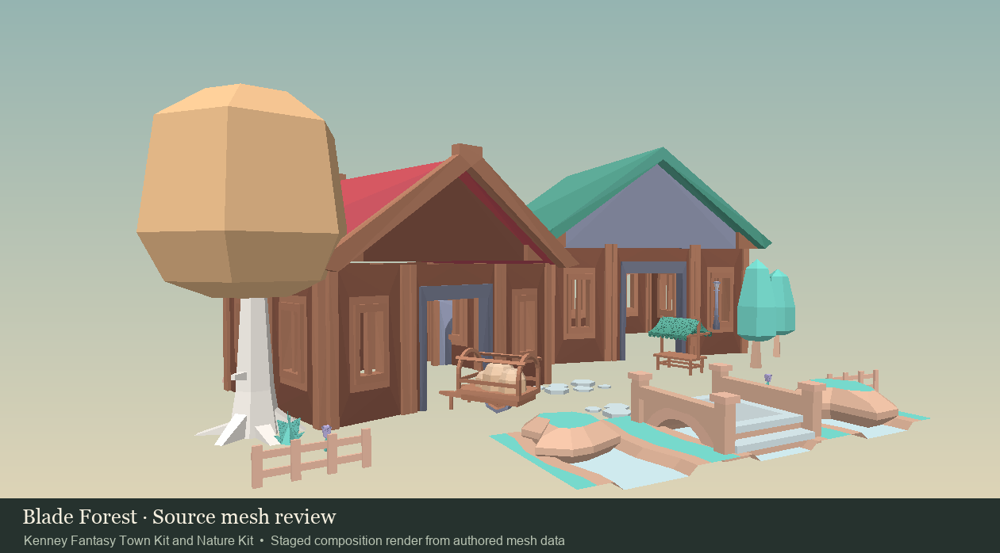

# Blade Forest — Professional Asset Rebuild results

**Incomplete.** The CC0 asset catalog and integration are prepared in source. Roblox Studio MCP rejected uploads from the local intake folder. The previous v87 visual build remains active in the private place. No replacement asset was installed.

## Delivered in the branch

- [Visual style bible](BLADE_FOREST_VISUAL_STYLE_BIBLE.md) and [source and license manifest](PROFESSIONAL_ASSET_MANIFEST.md).
- A coherent Kenney environment family in two self-contained packages. The comparison sheet contains **11** meshes. The full catalog contains **44** meshes, including **21** Timber and Frost tree variants and **three** buildings assembled from the creator's modular assets. Five licensed Kenney particle sprites are staged.
- Reversible source integration covering all eight Timber districts, the Records Lodge, the Crystal annex and the Frostgate, Monarch and Sanctum areas. Existing tree IDs, HP and rewards remain authoritative. The proposed render replacements leave the hitboxes, prompts, board rows, trees and gameplay locations in place. These placements await in-client validation.
- The Roblox engine compiled the four changed or new Luau sources without installing them. Both GLBs passed structural and embedded texture checks. The asset bank gate requires each tree and prop entry plus the five licensed effect texture IDs.

The image is a local perspective render of the actual authored meshes rendered outside Studio. Local review found mismatched roof ends in the first assembly. Switching to the kit's complete gables and orienting the shutter and doorway modules to the street corrected the issue in the review render. Blender 4.5.16 crashed during Metal initialization in this session, so a static glTF converter normalized and assembled the licensed mesh data directly. The conversion and review tools are checked in.

## Studio baseline and remaining verification

The six-second Studio baseline used one isolated QA account, a 957 × 532 viewport, Low graphics, Reduced Motion and fixed camera poses after streaming settled. These are local Studio measurements.

| Camera | FPS | Median frame time | p95 frame time | Client memory |
| --- | ---: | ---: | ---: | ---: |
| Haven Village `(-52, 14, -3023)` | 6.6 | 143.1 ms | 232.2 ms | 7,127 MB |
| Crystal Wilds `(2776, 17, -48)` | 8.4 | 92.1 ms | 220.8 ms | 7,124 MB |
| Winter Sanctum `(6262, 18, -12)` | 8.6 | 117.4 ms | 171.5 ms | 7,118 MB |

The asset-led after shots, import and texture verification, station collision and route checks, actual chop and regrowth smoke tests, boss art review and after measurements are pending. The source-proposed Crystal outcrops require a silhouette review. No physical phone test ran.

## Save and rollback

- Place `103379930563763`, universe `10777797608`. The last numerically confirmed visual build is **v87**, corresponding to `Workspace.UltimateVisualDevBuild=56c23ffb1ca70ea15b45457af045a770bf4cdba9`. The later private cloud save was confirmed at **2026-11-22T07:02:47.260Z** after the isolated QA flag was cleared. Its numeric version was unverified. Team Create reported no unsaved changes. Studio was released in Edit mode.
- Rollback checkpoint `2026-11-22T06:49:28.114Z`. `ServerStorage.ProfessionalArtRollback` contains six unchanged baseline source copies recorded against private v87 and Git `db3a009baf4b211d90ef32e5f0a4a9bc7383c54c`. The professional-art switch is absent from the saved editor. Trading and paid gifting stay disabled. Production was untouched.
- Prepared implementation commit `0e1c21e0390c683bca28cbb7afa980472cd3a5ec` on `art/professional-asset-rebuild`.
- The Roblox Studio `rbx-import-asset` workflow requires an approved uploads directory. The owner needs to add this workspace's `work/art-intake` folder in **Assistant Settings → MCP Permissions → Approved upload directories**. Asset read and write scopes were verified. After approval, the review GLB is the first upload, followed by quarantine, dependency checks and a player-height Studio review before placing the wider catalog.
