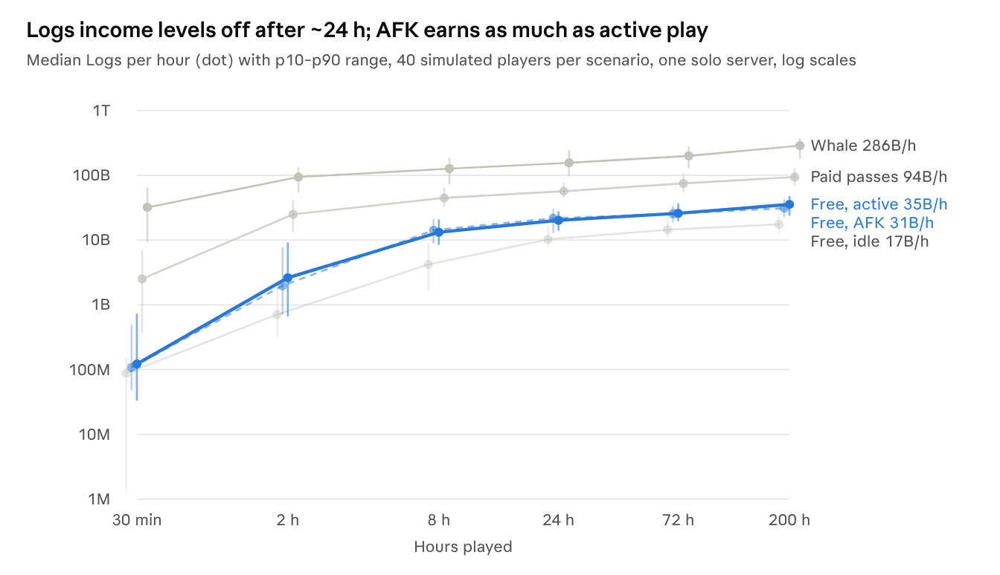

# Blade Forest — Complete System & Economy Audit

> **Exported from Claude Docs** ("Blade Forest — Complete System & Economy Audit", doc rev 20) on 2026-11-20. Full content, unedited, except that the embedded chart is reproduced as an image plus its data table. Read-only audit of `m0/foundations` @ `75f5985` (dev place v23). Simulator source and results: [`sims/`](sims/).


Nov 20, 2026 · Hyper Lykan (owner) · Read-only audit of branch `m0/foundations` (dev v23). No Studio, repo, save or production changes.

## 1. Executive summary

**Verdict: the game is server-authoritative and has no critical exploit, but its economy is unbounded and front-loaded. Six P0 items (five small fixes and one real-server test) and three owner decisions are needed before M1.** There are 30 findings: 0 critical, 7 high, 12 medium, 11 low.

**What is solid:**

- Every reward, roll, purchase and save is decided on the server.
- The 11 remotes validate their inputs.
- M0's session lock, backups and receipt flow are correctly designed.

**What must change:**

1. **Two M0 save defects.** Overlapping saves from one server can overwrite newer data, including a purchase already answered as granted (H2). Leaving during a first-time migration leaks the lock for 5 minutes (H3). Both are small fixes. Nothing about M0 is verified on real servers yet.
2. **Client position is trusted.** A speed or teleport exploit can sweep forests and every tree is credited (H1).
3. **The economy multiplies without limit (H4).** Ten bonus sources multiply together. A free player's LogMult reaches about ×122 at 200 h, a whale's about ×600, before events. Every planned system would multiply again.
4. **Progression is front-loaded (H7).** Free rolls plus very cheap Luck upgrades put the median free player in Crystal Wilds in **11 min** and at Frost Power in **3.5 h**, against the blueprint's 22-25 min and 4-8 h.
5. **Future content would take away legitimate bonuses (H5).** Index bonuses are recomputed live, so adding a weapon or tree removes completion bonuses.
6. **AFK equals active play.** AutoChop with the 17-minute server hop earns 97-109% of active income indefinitely. Playtime gifts reset on every rejoin (H6).

**Economy headline (free player, model calibrated to an observed session):**

| Played | Median income | Median cumulative Logs |
| --- | --- | --- |
| 2 h | 2.6B/h | 1.92B |
| 24 h | 20B/h | 335B |
| 200 h | 35B/h | 5.4T |

- **Pay gap:** passes earn about 3× free; a whale about 8×.
- **After about 24 h** progress depends only on rebirth cost (1M × 3^n) and Divine-weapon luck.
- **Forest density** is the largest single lever: about 4.6× income.
- **A crowded server shrinks income:** Crystal Wilds supplies only about 48 trees/s per server, so 20 players each get about 14% of solo income.

**What the rest of the report provides:**

- A future-system framework (§6) and a 72-node, 240-TP Tech Tree that cannot feed the Logs spiral (§7).
- Central capped pools: free max ×54, paid ×119, 2.2× (§8).
- 15 blueprint corrections (§9.2) and a prioritized checklist (§10).

**Owner decisions needed:**

1. Adopt the pooled formulas and the migration path for today's multipliers.
2. Set the AFK target ratio.
3. Approve a private dev publish for the real cross-server lock test.

This was a read-only audit: nothing was built and nothing was changed.

## 2. Current-system inventory

The game has 42 Luau files and 11,833 lines on `m0/foundations` @ `75f5985`. All persistence and rewards are server-authoritative, behind 11 client-callable remotes. Line counts and roles were read from the source. Studio was inspected read-only: one DataStore `GetAsync` of the dev profile, used to calibrate the economy model.

### Server (ServerScriptService)

| Script | Lines | Role |
| --- | --- | --- |
| DataService.luau | 844 | Profiles, LogMult/Luck stacking, weapons, stars, Shiny, crates, load/save (M0) |
| CombatServer.server.luau | 565 | 20 Hz blade hit detection, damage, tree/NPC rewards, respawn, upgrade shop remote |
| WorldServer.server.luau | 410 | Slimes, Rogue Lumberjacks (blade NPCs), Blade King boss |
| MetaService.server.luau | 297 | Prefs, rebirth, luck events, daily login, playtime gifts, quests, codes, index claims |
| ExtrasService.server.luau | 285 | Pets/eggs, sawmill (Logs→Souls), achievements, Ancient Treant world boss |
| Analytics.luau | 284 | M0-F analytics baseline |
| StoreService.server.luau | 252 | Game passes, developer products, receipts (M0-C), VIP daily crate |
| TravelService.server.luau | 223 | Island travel (Timber Haven, Crystal Wilds, Frostbound Reach) |
| SessionStore.luau | 205 | M0-A session-locked DataStore I/O |
| TraitService.server.luau | 166 | Trait crates (Logs, Souls, Free) + title |
| LeaderboardService.server.luau | 149 | 6 global OrderedDataStore boards |
| PvPService.server.luau | 136 | Per-player PvP toggle (×1.5 Logs) |
| Progress.luau | 115 | Quest counters, tree index, shared reward granting |
| PaidRandomPolicy.luau | 109 | M0-D PolicyService gating |
| ReceiptProcessor.luau | 100 | M0-C receipt state machine |
| RollService.server.luau | 83 | Free weapon rolls + global big-pull announcements |
| SaveMigrations.luau | 81 | M0-B numbered migrations |
| AreaService.server.luau | 42 | Power gates, BestArea tracking |
| SoulService.server.luau | 39 | Soul Shop |
| AFKService.server.luau | 31 | Anti-idle server hop (TeleportService) |
| AnalyticsBoot.server.luau | 5 | Starts analytics |

### Shared, ServerStorage and client

| Group | Files (lines) |
| --- | --- |
| Shared | BladeConfig (903, all balance numbers), UITheme (171), UIIcons (47) |
| ServerStorage | TreeKit (130, tree builder + mutation roll), SwordTools (72), M0Tests (412, Studio-only harness) |
| Client | ChopEffects (755), MetaController (526), UIController (500), RollController (491, auto-roll), BladeEffects (419), PvPSoulController (379), TraitsController (371), AutoChop (366), ExtrasController (364), IndexController (346), UIStyler (334), StoreController (273), AFKController (254, AFK mode + 17-min server hop), TutorialController (195), HudExtras (104) |

### Remotes (client → server)

| Remote | Handler | Rate limit | Notes |
| --- | --- | --- | --- |
| Roll | RollService:63 | Interval × 0.85 | Free, no altar/position check |
| ShopAction | CombatServer:44 | None | Upgrade, Equip, Fuse, Setting |
| Meta | MetaService:68 | 0.15 s | Daily, gifts, quests, codes, index, rebirth |
| Extras | ExtrasService:49 | 0.2 s | Hatch, pets, sawmill, achievements |
| TraitAction | TraitService:96 | 0.4 s (Roll) | Policy-gated (M0) |
| SoulShop | SoulService:12 | 0.3 s |  |
| Travel | TravelService:152 | 3 s cooldown |  |
| PvPToggle | PvPService:94 | 10 s |  |
| GetData | DataService:146 | **None** | Full profile deep copy per call |
| Leaderboards | LeaderboardService:119 | None | Cached |
| AFKRejoin (event) | AFKService:16 | Busy flag | Triggers a TeleportAsync |

Server → client: DataSync (whole profile snapshot), Notify, Reward, SoulReward, Hits, Shatter.

### Content and save data

- **Content:** 43 weapons (39 rollable, 4 exclusive: Founder's Edge, plus 3 bought with Souls); 28 tree types across 4 areas (7 rarities each); 4 mutations; 6 traits; 7 pets; 3 luck events; 3 islands; 5 upgrades; 6 game passes plus 9 developer products (all products have ProductId 0, so they are inactive).
- **Save (v4):** `BladeForest_v3` / `p_<UserId>`. Weapons are an aggregate `{Copies, Star, Pulled, Shiny}` per weapon id, with no per-item identity; `WeaponItems` is reserved but empty. Pets are counts per id. Trait is a single id. Purchases are a permanent set of ids. Also stored: `CrateOrigins`, `RetiredWeapons`, `_Meta`, `_Session`.
- **Unused configuration:** `Config.Altars`, `Config.GetRollOdds`, `Rarities[].Chance` and `Areas[].RollCost` are no longer read by any script, because rolling moved to the free global pool.

## 3. Findings

There are 0 critical, 7 high, 12 medium and 11 low findings. No finding gives a client direct control of damage, currency or items: every grant runs on the server. The high findings are an exploitable trust in client character position, two save-safety gaps in M0, three economy-structure problems that future content will make worse, and a session-reset reward exploit. Line numbers refer to `m0/foundations` @ `75f5985`.

### High

| ID | Area | Location | Finding and evidence | Recommended correction |
| --- | --- | --- | --- | --- |
| H1 | Security / economy | CombatServer.server.luau:545-550; AreaService.server.luau:16-41 | Hit detection uses the client-owned `HumanoidRootPart` position. Nothing checks movement speed or teleports. A speed or teleport exploit can sweep any forest and every tree is credited server-side. AreaService only checks the Power gate. | Add server movement sanity: maximum distance per tick from WalkSpeed, a teleport whitelist (Travel, AFK), and rubber-band or flag violations. Cap credited trees per second per player at about 1.5× the modelled maximum. |
| H2 | M0 saves | DataService.luau:738-742; SessionStore.luau:141-171 | `SaveNow` waits at most 30 s for an in-flight save, then starts a second write. The write transform checks only the session id, not order. An older snapshot that finishes last overwrites a newer one. If the newer one held a receipt grant already answered `PurchaseGranted`, **that purchase is lost** (not duplicated). The 30 s limit can be reached: 4 retries with 15 s of backoff plus call latency. | Add a monotonic `_Session.Seq`: the transform refuses a write whose sequence is lower than the stored one. Queue saves per player instead of using a timed wait, and never clear `saving[player]` from an older write. |
| H3 | M0 saves | DataService.luau:717-729 | If a player leaves while `BuildProfile` writes the first-time migration backup (a yield), `finishLoad` returns early and the profile is never stored. PlayerRemoving has already run with no profile, so **the session lock leaks for the 300 s lease**. A quick rejoin is refused for about 45 s and then kicked with "still open in another server". | After `BuildProfile`, if `player.Parent` is nil, release the lock by writing back the untouched raw record with `release = true`, as the early-leave branch already does. Add a test for leaving during migration. |
| H4 | Economy | DataService.luau:205-248 (`RecalcMultipliers`) | All Logs sources multiply together with no cap: trait ×3, 2xLogs ×2, VIP ×1.1, Log Boost ×2, rebirths (1+0.25n), PvP ×1.5, pets up to ×9, weapon index ×1.4, tree index ×1.2, events ×2. A plausible late build reaches about ×1,400 before events. Simulated incomes pass 10^11 Logs/h (§4). Every future system that adds another factor multiplies this again. | Move to the central stacking model in §8: additive pools within a category, multiplicative only across a few categories, soft cap on the total. |
| H5 | Future compatibility | DataService.luau:162-201 | Index and tree-index bonuses are **recomputed live** from the current catalog. Adding one weapon or tree type to an existing area silently removes +10% Luck/+10% Logs (or +5% Logs) from every player who had completed that area. | Make completion sticky: store completion per catalog version or per area "edition". New content adds a new edition with its own bonus and never revokes an old one. |
| H6 | Economy exploit | MetaService.server.luau:31-48, 92-101, 205 | Playtime gifts are tracked per server visit (`sessionStart` is reset on join). Rejoining every 10 minutes repeatably pays 1× crate-cost Logs plus 15 Souls. Rejoining every 45 minutes adds a Trait Crate each time. The AFK server hop (17 min) also resets the timer. | Store gift progress in the profile against a daily or rolling-24 h playtime counter, not per server visit. |
| H7 | Progression design | BladeConfig.luau:376-381, 441-449; RollService.server.luau:20-69 | Rolls are free and unlimited (about 3,300/h auto, about 7,000/h with Fast Roll), and Luck levels are cheap (level 27 costs about 7k Logs). The modelled free player passes Starter Grove and Pine Forest within minutes: the median reaches Crystal Power (250) in 11 minutes (p90 28 min) and Frost Power (2,000) in 3.5 h (§4). Two of the four areas act as a short tutorial. | Gate area entry on more than weapon Power (for example a quest or Tech Tree node per island), raise the Luck cost curve, and/or make early luck additive and capped (§8). |

### Medium

| ID | Area | Location | Finding and evidence | Recommended correction |
| --- | --- | --- | --- | --- |
| M1 | AFK / saves | AFKService.server.luau:16-30 | The AFK hop saves without releasing the lock, then teleports. The new server's Acquire waits up to 45 s (15×3 s) for the old server's PlayerRemoving release. If that release fails, the AFK player is kicked and locked out for up to the 300 s lease. The client-supplied `session` table goes into TeleportData unvalidated (display only today). | Make the hop a handoff: `SaveNow(player, true)`, freeze the profile, then teleport. On the new server, accept a lock whose Job matches a recorded handoff. Clamp and sanitise the session table. |
| M2 | Fairness | CombatServer.server.luau:365-375 | The last hitter gets the tree's whole reward. In a shared dense forest, a high-damage player steals trees others have mostly chopped. | Split by damage share, as the Treant does, or give the reward to the player with the largest share. |
| M3 | Network | DataService.luau:123-153; Progress.luau:72 | Each quest or progress change triggers a full-profile `DataSync` (about 4 KB, up to 10/s per player). With 20 players chopping that is about 0.8 MB/s server egress. `GetData` has no rate limit and deep-copies the whole profile on every call. | Send delta updates (changed keys only), rate-limit `GetData` (1/s), and batch quest-progress syncs to 1/s. |
| M4 | Economy | BladeConfig.luau:596-600, 649-652, 772; AreaService.server.luau:34-36 | Crate, egg, Log Pack and Logs-reward prices scale with `BestArea`, which only rises. Delaying entry to a new area keeps eggs at 1,125 Logs: about 3,000 eggs for 3 Dragons costs about 3.4M Logs in Starter versus about 36B at Frost. | Price by current progression tier (Power or rebirth band), or fix prices per item and scale rewards separately. |
| M5 | World boss | ExtrasService.server.luau:186-188, 235-245 | Treant HP scales with the total Power of **everyone online**, including AFK players elsewhere. Any non-zero damage share earns 40+ Souls, a Trait Crate and 3× crate-cost Logs. That makes the Treant the largest free crate source (up to 3/h) for one touch each. | Scale HP by participants within range. Require a minimum share (for example 2%) or 10 s of contribution for full rewards. |
| M6 | Paid-random policy | PaidRandomPolicy.luau; StoreService.server.luau | Restricted players can still be prompted for and buy Trait Crate products whose crates they cannot open. The Lucky Crates pass is still sold to them. Legacy crates are locked even for players who never paid. Once any Log Pack goes live, Souls become Robux-reachable through the Sawmill, but the Souls crate path (\`TraitCrate\_Souls\`) is never gated (PaidRandomPolicy.luau:83-88). | Add a server-side purchase gate before any product goes live. Hide paid-random products for restricted players. Reclassify Legacy as Earned when the profile has no purchases, Starter Pack or VIP. |
| M7 | Weapons / trading | DataService.luau:56-105 | Weapons are one aggregate entry per id with no per-item identity, origin or trade lock. Trading, vaults, awakenings and runes all need item instances. | Populate `WeaponItems` (UID, base id, origin, created time, flags) in a versioned migration before any trading work (§6). |
| M8 | Area balance | BladeConfig.luau:114-127; Crystal Wilds layout | Dense Crystal Wilds (about 1 tree per 31 stud²) out-earns Frost content until Power is well above the Frost gate. The model's free players stay in Crystal even with 3,000+ Power (§4), so the island order and the income order disagree. | Balance per-island tree density with reward per tree, or tune Frost rewards and HP against the Crystal Wilds density, before Frostbound Reach construction. |
| M9 | Index design | DataService.luau:162-168; BladeConfig.luau:216, 227 | A weapon index requires every non-exclusive weapon in the area, including its rarest: 1-in-1.5M (Starter), 1-in-2.5M (Pine), 1-in-10M (Crystal) and 1-in-100M (Frost Divine). The +10% Luck/Logs completion bonuses are therefore end-game rewards for every area, including the first. | Exclude Secret and Divine tiers from completion, or move them into a separate "Mastery" index with its own bonus. |
| M10 | Bosses | WorldServer.server.luau:326; BladeConfig.luau:14-15 | Blade King HP is capped at 8k-60k and the reward pool is a fixed 5,000 Logs and 200 Souls. A mid-game build kills it in seconds and the reward is negligible next to chop income. | Scale HP and rewards by tier (Power or island), as the Treant scales rewards with crate cost. |
| M11 | Rolls | BladeConfig.luau:426-427; RollService.server.luau:65-66 | The Fast Roll client auto-roll interval is 0.4 s, but the server cooldown is 0.6×0.85 = 0.51 s. About every other request is refused with "cooldown", so the pass delivers about 0.8 s per roll, not the advertised rate. | Set `FastAutoRollInterval` ≥ 0.52 s, or queue client requests. |
| M12 | Analytics | Analytics.luau:25-90 | The global send budget of 20 events/s (1,200/min) has not been checked against current AnalyticsService throttles. Drops are counted but not surfaced. | Confirm the documented limits, lower the per-server budget if needed, and alert on `dropped > 0`. |

### Low

| ID | Area | Location | Finding | Correction |
| --- | --- | --- | --- | --- |
| L1 | Display | BladeConfig.luau:518-525 | `FormatNumber` stops at "B", so 10^12 shows "1000.0B". Modelled late-game balances reach 10^11-10^13. | Add T, Qa and Qi suffixes. |
| L2 | Saves | DataService.luau:708, 723 | A brand-new player who leaves while loading gets an empty `{}` record. The next join migrates it as "v0" with a trivial backup. | Release by removing `_Session` only (or deleting a key that was empty before). |
| L3 | Pets | ExtrasService.server.luau:28-30; DataService.luau:223 | Equipped pets are not re-validated against the slot count on load. A lost VIP pass (refund) keeps 4 equipped. | Clamp `EquippedPets` to `maxPets` in `prepare` and on pass checks. |
| L4 | Remotes | ExtrasService.server.luau:125-126 | `SawmillSell` accepts NaN (`NaN <= 0` is false). The result is a full-cap sale that is still paid for, so it is harmless today. | Reject non-finite numbers in every numeric remote argument. |
| L5 | Leaderboards | LeaderboardService.server.luau:133 | The push on leave races DataService's release (the profile may already be nil), so final totals can be skipped. | Push from DataService's release path, before the profile is dropped. |
| L6 | Spam | MetaService.server.luau:195; CombatServer.server.luau:111-116 | Server-wide notices fire for every rebirth and every Legendary+/mutated respawn. With dense forests and many rebirths this becomes noise. | Throttle global notices; keep them to Secret or Divine and milestones. |
| L7 | Dead config | BladeConfig.luau:26-35, 53-58, 294-357 | `Altars`, `GetRollOdds`, `Rarities[].Chance` and `Areas[].RollCost` are unused since rolling moved to the global pool. | Remove them or mark them legacy, to avoid wrong balance edits. |
| L8 | Rebirth | MetaService.server.luau:186-196 | Rebirth spends **all** Logs, including any excess over the cost, and keeps `BestArea`. | Spend only the cost (or show a confirmation with the amount lost). |
| L9 | Precision | DataService.luau:285-299 | Logs are float64. Precision loss starts above 9×10^15, which the model reaches with long play under the current stacking. | Cap via §8. Optionally store long-term totals as mantissa and exponent. |
| L10 | Codes | MetaService.server.luau:116-128 | Code rewards scale with BestArea (TIMBER = 10× crate cost, so 80M Logs at Frost). Fine today; becomes a lever if codes are reused for events. | Use fixed amounts per code. |
| L11 | Quests | Progress.luau:12-13 | Daily and weekly keys use UTC, so the reset lands mid-day for US players. This is a product choice, not a bug. | Document it, or pick a fixed reset hour. |

## 4. Economy model and simulation results

A free player who uses AutoChop earns a median **20B Logs/h after 24 h** and **35B/h after 200 h**. Income rises about 100× in the first 8 hours, then flattens: the 3^n rebirth cost and Divine-weapon luck become the only levers. Passes give about 3× the free income and a whale build about 8×. The model was calibrated to an observed dev-profile session: it predicts 3,438 Logs/s against about 3,400 observed for the same build in Crystal Wilds.



*Chart: median Logs per hour (dot) with p10–p90 range, 40 simulated players per scenario, one solo server, log scales. Source: `sims/sim.py` on BladeConfig @ 75f5985 · model estimate, one solo server (see 20-player sharing below).*

Chart data — Logs income per hour, median (p10–p90), from `sims/results/res_*.json`:

| Scenario | 30 min | 2 h | 8 h | 24 h | 72 h | 200 h |
| --- | --- | --- | --- | --- | --- | --- |
| Free, idle | 87.82M (1.33M–152.82M) | 709.06M (318.22M–1.84B) | 4.18B (1.64B–8.75B) | 10.22B (7.83B–16.52B) | 14.39B (10.84B–22.24B) | 17.41B (12.80B–25.45B) |
| Free, AFK | 107.78M (48.02M–496.83M) | 1.97B (699.64M–7.79B) | 14.17B (8.85B–21.12B) | 21.65B (12.85B–30.23B) | 25.35B (18.69B–33.60B) | 30.98B (22.45B–42.91B) |
| Free, active | 121.86M (33.26M–728.42M) | 2.61B (658.33M–9.19B) | 13.17B (8.41B–20.78B) | 20.12B (13.97B–27.63B) | 25.77B (19.51B–36.64B) | 35.37B (23.65B–47.50B) |
| Paid passes | 2.51B (369.22M–6.93B) | 24.90B (13.20B–40.77B) | 44.64B (32.51B–66.08B) | 56.51B (45.05B–78.25B) | 74.68B (53.41B–107.15B) | 93.63B (69.14B–130.12B) |
| Whale | 31.81B (9.21B–65.33B) | 93.62B (53.89B–133.80B) | 126.12B (71.95B–184.36B) | 155.05B (95.46B–242.22B) | 198.24B (127.75B–273.41B) | 285.96B (178.29B–372.67B) |

The paid and whale lines sit above the free lines from the first 30 minutes. AFK and active free play overlap at every horizon. That is the AFK finding in §5.

### How the model works

The simulator reads every balance number from `BladeConfig.luau`, so a config change is picked up by re-running it. It reproduces these game formulas:

- **Damage per hit:** Power × StarMult × Shiny × (1 + 0.1·Damage) × overflow spin (`GetStats`).
- **Hits:** each blade hits each tree in its sweep once per revolution, and the 0.4 s per-blade cooldown never binds (`CombatServer.processWielder`). A tree above your Power takes ×0.1 damage.
- **Trees:** a tree respawns after `Respawn` seconds with a freshly weighted type and mutation. Mutations average ×1.157 Logs and ×1.041 HP.
- **Rolls:** free; weapon w hits with chance Luck/OneIn (for OneIn > 10), rarest first; every 10th roll gets ×2 Luck; auto-roll every 1.1 s, or 0.51 s with Fast Roll.
- **Stacking:** LogMult and Luck stack exactly as `RecalcMultipliers`. Luck events average ×1.078 Logs and ×1.141 Luck.
- **Costs:** upgrade cost is BaseCost × CostMult^level. Rebirth costs 1M × 3^n and resets Logs and upgrades.

These assumptions are not in the code:

- **A1, forest density:** Crystal Wilds dense zones 1 tree / 31 stud² (measured nearest neighbour about 5.2 studs); other areas 1 / 150 stud² (an estimate).
- **A2, AutoChop movement:** 16 studs/s through the forest, combining the encounter rate and the kill time.
- **A3, behaviour:** *Active* = AutoChop + auto-roll + Treant 50% + about 30 NPC Souls/h + claims. *AFK* = AutoChop + auto-roll only. *Idle* = standing still with auto-roll.
- **A4, spending:** greedy return-on-investment on chop upgrades; Luck when cheap; crates and eggs with a margin; rebirth when Logs ≥ cost and (upgrades maxed or Logs ≥ 3× cost).
- **A5, player variation:** a per-player efficiency factor, lognormal with σ = 0.25.
- **A6, long horizons:** one daily login and quest set per 4 played hours.

**Scenarios:**

- **Free** has no purchases.
- **Paid** owns 2xLogs, 2xLuck, VIP, Blade Slot, Fast Roll and the Starter Pack, about 1,594 Robux one-time.
- **Whale** is Paid plus Mega Luck and Log Boost kept active at all times. At list prices that is about 950 Robux per played hour, using products that are not active yet.

### Progression milestones (time to reach the Power gate)

| Scenario | Pine Forest (40) p10 / p50 / p90 | Crystal (250) p10 / p50 / p90 | Frost (2,000) p10 / p50 / p90 |
| --- | --- | --- | --- |
| Free, active | 0 / 1 / 2 min | 3 / 11 / 28 min | 59 min / 3.5 h / 7.6 h |
| Free, AFK | 0 / 0 / 2 min | 4 / 10 / 22 min | 74 min / 3.2 h / 7.1 h |
| Free, idle | 0 / 1 / 2 min | 2 / 12 / 31 min | 2.2 / 4.6 / 8.5 h |
| Paid | 0 / 0 / 0 min | 2 / 4 / 11 min | 27 / 80 / 150 min |
| Whale | 0 / 0 / 0 min | 0 / 2 / 2 min | 7 / 16 / 30 min |

### Free active player at each horizon (p10 / median / p90)

| Played | Logs earned (cumulative) | Power | Rebirths | LogMult | Luck |
| --- | --- | --- | --- | --- | --- |
| 30 min | 5.1M / 31.6M / 101M | 269 / 554 / 956 | 0 / 0 / 1 | 2.0 / 2.5 / 6.8 | 3.5 / 4.4 / 6.2 |
| 2 h | 615M / 1.92B / 7.06B | 651 / 1,100 / 3,200 | 1 / 1 / 5 | 12.5 / 18.8 / 41.5 | 8.8 / 11.8 / 24.3 |
| 8 h | 28.1B / 55.8B / 94.3B | 2,100 / 3,000 / 7,100 | 8 / 9 / 9 | 52.5 / 57.3 / 71.7 | 29.7 / 31.4 / 37.6 |
| 24 h | 233B / 335B / 473B | 3,800 / 5,800 / 9,800 | 10 / 11 / 11 | 70.7 / 82.7 / 86.3 | 36.3 / 40.6 / 41.6 |
| 72 h | 1.04T / 1.47T / 2.05T | 6,700 / 10,200 / 19,900 | 12 / 12 / 12 | 88 / 96 / 115 | 43.6 / 43.6 / 47.2 |
| 200 h | 3.88T / 5.44T / 7.44T | 10,600 / 14,600 / 19,900 | 13 / 13 / 14 | 102 / 122 / 129 | 49.3 / 49.3 / 53.1 |

At 24 h, cumulative Logs earned (median) are 335B free active, 365B free AFK, 153B idle, 1.08T paid and 3.01T whale. At 200 h they are 5.4T, 5.3T, 2.8T, 15.5T and 44.5T.

### Upgrade affordability

| Upgrade | Max level | Cost of last level | Total to max | Free active player, median (model) |
| --- | --- | --- | --- | --- |
| Blades (+1 blade) | 5 | 10.5M | 11.1M | Maxed by 2 h; re-bought within minutes after each rebirth |
| Speed | 50 | 5.4M | 24.6M | Bought to level 17 (the 5.5 rad/s cap) within 30 min. Levels 18-50 only add overflow damage, which is low value, so they stay unbought |
| Damage | 100 | 40.8M | 313M | **Rarely maxed:** median level 18 at 8 h and 14 at 200 h. Once trees die in 1-2 hits, active income is limited by walking, not damage, so this upgrade stops paying back mid-game |
| Reach | 40 | 1.7M | 7.2M | Maxed by about 30 min (median level 39); the most valuable upgrade in dense forests |
| Luck | 100 | 361M | 2.62B | Median level 100 by 8 h. Rebirth resets it like every upgrade, and it is re-bought within minutes |

| Rebirth n | 0 | 2 | 4 | 6 | 8 | 10 | 12 | 14 | 16 |
| --- | --- | --- | --- | --- | --- | --- | --- | --- | --- |
| Cost (Logs) | 1M | 9M | 81M | 729M | 6.6B | 59B | 531B | 4.8T | 43T |

### Bottlenecks

1. **Hours 0-8: none.** Every upgrade costs less than a few minutes of income once a player is in Crystal Wilds, so progress is gated only by weapon rolls.
2. **Hours 8-24: rebirth cost.** Each rebirth adds +25% Logs (additive) but costs 3× the previous one. By rebirth 12 (531B) one rebirth takes about a day of free play.
3. **Beyond 24 h: luck for Divine weapons.** FrostboundReaper (1 in 100M) is the Power ceiling at 19,905, or 74,644 at 5★ Shiny. Free median Luck plateaus near 49×, so the free p90 owns it at 72 h and the median still does not at 200 h.
4. **Content ceiling.** After FrostboundReaper and about 14 rebirths there is nothing left to buy except Logs-scaled crates and eggs. Souls pile up with no sink: the free active median holds 27.9K unspent Souls at 200 h.
5. **Crowding.** Crystal Wilds sustains about 48 trees/s in total (620 trees, mean respawn 13 s). One mid-game player wants about 17 trees/s. **With 5 players each gets about 55% of solo income; with 20, about 14%** (`shared.py`). Solo-server figures are therefore upper bounds.

**Sensitivity:** forest density is the largest single economy lever. In a 30-player re-run with every area as dense as Crystal Wilds (A1 changed, nothing else), 97% of free players farm Frost by 8 h (compared with 3% at the baseline density). Their median income at 24 h is \*\*93B/h instead of 20B/h (4.6×)\*\*, and cumulative Logs at 72 h are 7.0T instead of 1.5T. Island construction (Timber Haven redesign, Frostbound Reach) must therefore be balanced against density, not only per-tree rewards (finding M8).

**Reproduce:** run `python3 sim.py <free|paid|whale> <active|afk|idle> <hours> <agents>`, `python3 shared.py` and `python3 summarize.py` in `/home/claude/audit_sim` (scratch folder, not committed).

## 5. AFK economy analysis

**An AFK player with AutoChop earns 100-109% of an active free player's Logs** (median 365B against 335B at 24 h, 5.27T against 5.44T at 200 h). The anti-idle server hop lets that run without limit, so every hour a player leaves the game running counts as a full active hour. Standing still without AutoChop earns about half as much (46% at 24 h).

| Median, free player | 8 h | 24 h | 200 h |
| --- | --- | --- | --- |
| Logs earned: active / AFK / idle | 55.8B / 57.7B / 16.3B | 335B / 365B / 153B | 5.44T / 5.27T / 2.81T |
| AFK as % of active | 103% | 109% | 97% |
| Souls held: active / AFK | 1.2K / 260 | 3.3K / 580 | 27.9K / 4.1K |

**Why AFK matches active play:**

1. **AutoChop does the core loop.** It picks the best tree by Logs per second (`AutoChop.client.luau:116-138`), walks there and leaves the blades to work. Nothing a present player does is more efficient, and the only active extras (Treant, NPC kills, claims) are small next to chop income.
2. **Auto-roll runs during AFK**, so weapon progress, the main progression gate, is identical.
3. **The idle kick is bypassed.** At 17 idle minutes the client fires `AFKRejoin` and the server teleports the player to a fresh server (`AFKController.client.luau:238-246`, `AFKService.server.luau:16-30`). Roblox's 20-minute idle kick never triggers.
4. **Passes and boosts apply in full** while AFK.

**What AFK players do miss:** Souls (6.8× fewer at 200 h, so traits and Soul Shop items come later), Treant crates, playtime gifts (each hop resets the per-visit timer) and quest claims until they return.

**Side effects on other players:**

- **Forest share.** AFK players count fully against the forest supply (§4). With 10 strong AFK players in Crystal Wilds, an active newcomer gets about a quarter of their solo income, and less if the AFK players hit harder, because the last hit takes the whole tree (M2).
- **Server and network load.** Each AFK player keeps a full 20 Hz combat query and a DataSync stream alive (M3), and the hop adds a teleport plus a profile load every 17 minutes.
- **Lock risk.** Each hop is a save-and-teleport without a lock handoff (M1). An AFK player whose release fails is kicked on the new server.

### Recommendations

1. **Decide the target ratio explicitly.** A common simulator target is AFK at 30-60% of active. Get there with an "AFK mode" multiplier (for example ×0.5 on Logs and roll speed) applied while AFK mode is on. Server-side detection is better: no client input events and AutoChop on for more than 5 minutes.
2. **Make AutoChop an unlock** (Tech Tree node, §7) with tiers: speed or target quality improves with progression rather than being optimal from minute one.
3. **Replace the hop with a lock handoff** (`SaveNow(release)`, then teleport), cap hops per hour, and keep gift and quest timers in the profile (H6, M1).
4. **Give AFK players their own space** (a private AFK grove instance, or per-player trees in a dedicated zone) so they do not drain shared dense forests.
5. **Add an offline-earnings alternative** (for example sawmill workers capped at 8 h) so that leaving the game running is not the only way to progress while away. This also lowers server cost.

## 6. Future-update balance framework

Every future system can be added safely if it follows three rules:

- **Bonuses go into a small number of capped pools** (§8), never as one more multiplier.
- **Prices follow the player's island tier**, not a BestArea that only rises.
- **Content is versioned**, so additions never revoke what a player already earned.

Today's code breaks all three (H4, H5, M4). The table below gives the integration requirements, balance rules and save changes for each planned system.

| System | Integration requirements | Balance rule (feeds §8) | Save / compatibility |
| --- | --- | --- | --- |
| 120 weapons (43 + 77) | Per-island altar pools; Power = 5·OneIn^0.45 × island multiplier (1 / 4 / 16 proposed); a tree Strength ramp per island so a new island's Common equals its gate Power | Power stays the only weapon stat that matters for chopping. Legacy Power is frozen. Weapon reveal and announcement thresholds by tier | Catalog ids are permanent. A removed weapon goes to `RetiredWeapons` (already in M0). The index uses editions (H5) |
| 72-node Tech Tree | New currency, Tech Points (TP), earned from rebirths, Mastery Levels, island chains and collection milestones, **not** from Logs | Every node feeds an existing pool and its cap; no node grants currency (§7) | `TechTree = {Nodes = {[id] = true}, TP, Spent, Ver}`. Node ids are never reused; a respec refunds all TP |
| 100 Mastery Levels | Player-level XP from chops (XP = tree tier weight, not Logs), so it does not inflate with LogMult | +0.5% Logs per level into the permanent pool (+50% at 100); 1 TP every 2 levels | `Mastery = {Lv, XP}`. Rename the blueprint's per-tree "Tree mastery" to **Tree Badges** to avoid a name clash |
| Walk Speed upgrades | AutoChop income scales almost linearly with walk speed (the encounter-limited term in A2). H1's server movement checks must use the upgraded speed | Cap +50% (16 → 24 studs/s) in 25 levels of +2%. Count it in a Mobility pool that is excluded from AFK mode, otherwise it also boosts AFK income | `Levels.WalkSpeed`. Absent = 0 (reconcile) |
| Forest Renewal upgrades | Respawn is global per server, so one player's upgrade would raise supply for everyone and add TreeKit rebuild CPU | Apply it per player: trees *that player* fells respawn faster, or use a per-player instanced grove. Cap respawn at −40%. Re-run the shared-forest model (§4, 48 trees/s) | `Levels.Renewal`. Server CPU budget: at most +40% rebuilds per second |
| 12 traits, second slot | Keep the 6 old ids and values; add 6 non-Logs traits. The second slot unlocks on Frostbound (D7) | Both slots feed the permanent pool. Lucky Crates is a paid odds modifier, already gated for restricted players (M0) | `Trait2`; the `Trait` id is unchanged |
| 21 pets + evolution | 7 per island egg; evolution consumes exactly 3 | The pet pool is soft-capped at +300% (§8). Today 3 Dragons already give +600%, so **evolution must add secondary stats** (Souls %, walk speed, mutation chance) rather than more Logs | Counts per id stay. Evolved pets are new ids (`Dragon_G`, `Dragon_R`) so old counts are never reinterpreted |
| Forging, runes, awakening | Item identity first (M7). Altar Essence at 1 per roll is AFK-driven (about 3,300/h) | Cap Essence income per day, or earn it from manual rolls only. Awakening (up to ×1.6 Power) moves the Strength ramp, so re-check gate floors. Rune effects count inside their pools | `WeaponItems[uid] = {Base, Star, Shiny, Awaken, Runes, Origin, Created, Locked}`. Stacks remain for un-modified copies (D3) |
| Vaults and trading | Needs item UIDs, `Origin` (paid-random / earned / legacy), `PolicyService.IsPaidItemTradingAllowed`, and a **trade journal**: cross-key `UpdateAsync` is not atomic | Weapons and pets only, no currency. Trade lock 24 h after acquisition. No paid-random-origin items for restricted players | `Trades[tradeId] = {State, Give, Get}` on both profiles. Recovery on load finishes or rolls back a journal entry. 1,000-trade disconnect test (blueprint M7) |
| Guilds and co-op raids | Guild data under its own keys with a single writer (MemoryStore lease); raid HP scales by participants **in range**, not everyone online (M5) | Guild bonus ≤ +10% Logs into the permanent pool. Raid rewards need a minimum contribution (2% or 10 s) | `Guild = {Id, Joined}` in the profile. Guild record separate, versioned |
| Endless expeditions | Instanced per party; HP ×1.12^depth against reward ×1.08^depth, so reward per minute falls with depth (a natural cap) | No AFK eligibility; AutoChop off inside expeditions; per-run and per-day reward caps | `Expedition = {Best, Weekly}` |
| Seasons and events | Temporary multipliers use **strongest-only** (one potion or event at a time). Season currency expires or converts at the end | No permanent Power from a season; season items stay inside caps | Items earned are kept; the season record is archived |
| Islands 4, 5, … | Each island is a tier: Strength ×10, base Logs ×12 and prices ×12 against the previous one. Its reference density must make **income order = island order** (M8) | Price by island tier (M4). Re-run the simulator per island with `DENSITY` measured from the built layout | `UnlockedIslands` (exists). Gates are per island id, never per legacy area |

**Guarantees future updates must keep** (enforced by tests in M1):

1. A legitimately owned weapon, pet, trait, crate or Logs balance is never deleted or reduced. Removed content is parked (`RetiredWeapons` pattern) and restored if re-added.
2. A completed index, badge or mastery level is never revoked. New content opens a new edition.
3. Power of an owned weapon never decreases (legacy values frozen).
4. Any formula change that lowers a player's effective bonus by more than 10% needs owner approval and an in-game notice. Paid passes keep their exact advertised effect.
5. No source is uncapped. Each currency has a known maximum income per hour per tier, asserted by a simulator test in CI before release.

## 7. 72-node Tech Tree balance specification

The Tech Tree has **4 branches × 3 tiers × 6 nodes = 72 nodes**, costing **240 Tech Points (TP)** in total. TP is a non-tradeable progression currency that is never bought and never earned from Logs, so the tree cannot feed the Logs spiral. A free player is expected to fill about half the tree by about 40 h and all of it by about 200-250 h.

### Structure and costs

| Tier | Unlocks when | Node cost | Nodes per branch | TP per branch |
| --- | --- | --- | --- | --- |
| T1 | Timber Haven (start) | 1 TP | 6 | 6 |
| T2 | Crystal Wilds unlocked and 4 T1 nodes in the branch | 3 TP | 6 | 18 |
| T3 | Frostbound Reach unlocked and 4 T2 nodes in the branch | 6 TP | 6 | 36 |
| Capstone (node 18 of each branch) | All other 17 nodes in the branch | (included in T3) | — | — |

**TP sources (estimated 206 TP before seasons):**

| Source | TP |
| --- | --- |
| Rebirths, 2 TP each | \~28 by 200 h |
| Mastery Levels, 1 TP per 2 levels | 50 |
| Island quest chains | 10 × 3 = 30 |
| Collection milestones | 8 × 5 = 40 |
| Achievements | 18 |
| Expedition depth, 2 TP per 10 depths up to 200 | 40 |
| Seasons | The remainder |

**Rebirth needs this.** Today rebirth's only reward is +25% Logs (H4). Under capped pools it needs this second reward to stay meaningful.

**Respec:** free once, then 10% of the player's current island crate price. All TP are refunded on respec.

### Branch A: Forestry (chopping)

| # | Tier | Node | Effect | Pool (§8) |
| --- | --- | --- | --- | --- |
| A1 | T1 | Sharp Start | +5% blade damage | Damage |
| A2 | T1 | Quick Steps | +4% walk speed | Mobility (off in AFK mode) |
| A3 | T1 | Woodsman's Eye | AutoChop tier 1. **Granted free to every legacy profile** so no existing feature is taken away | Utility |
| A4 | T1 | Bark Collector | +5% Logs | Permanent |
| A5 | T1 | Clean Cuts | +5% blade damage | Damage |
| A6 | T1 | Wide Arc | +0.4 stud reach | Reach |
| A7 | T2 | Crystal Rhythm | +8% Logs | Permanent |
| A8 | T2 | Heavy Swing | Weak-tree damage ×0.1 → ×0.2 | Damage |
| A9 | T2 | Honed Edge | +8% blade damage | Damage |
| A10 | T2 | Mutation Sense | +10% relative mutation chance | Mutation |
| A11 | T2 | Woodsman's Eye II | AutoChop tier 2 (prefers mutated and high-value trees) | Utility |
| A12 | T2 | Swift Stride | +6% walk speed | Mobility |
| A13 | T3 | Frost Rhythm | +10% Logs | Permanent |
| A14 | T3 | Master Edge | +10% blade damage | Damage |
| A15 | T3 | Rich Grain | +15% Logs from mutated trees | Mutation |
| A16 | T3 | Forest Renewal | Your felled trees respawn 10% sooner | Renewal (per player) |
| A17 | T3 | Long Arc | +0.6 stud reach | Reach |
| A18 | Cap | Timber Tempest | +15% Logs, plus an aura | Permanent |

Branch A totals: +38% Logs, +38% damage, +10% walk speed, +1.0 reach, +10% mutation chance, +15% mutation Logs, −10% personal respawn.

### Branch B: Fortune (luck and rolls)

| # | Tier | Node | Effect | Pool |
| --- | --- | --- | --- | --- |
| B1 | T1 | Lucky Leaf | +0.05 permanent luck | Luck (permanent) |
| B2 | T1 | Eager Hands | Auto-roll 1.1 → 1.0 s | Roll speed |
| B3 | T1 | Clover | +0.05 permanent luck | Luck (permanent) |
| B4 | T1 | Essence Tap | +5% Altar Essence | Essence |
| B5 | T1 | Lucky Ninth | Lucky roll every 10th → every 9th | Luck (rhythm) |
| B6 | T1 | Steady Hand | Epic pity 100 → 95 | Pity |
| B7 | T2 | Four-Leaf | +0.10 permanent luck | Luck (permanent) |
| B8 | T2 | Quick Hands | Auto-roll −0.1 s | Roll speed |
| B9 | T2 | Essence Flow | +10% Essence | Essence |
| B10 | T2 | Charm | +0.10 permanent luck | Luck (permanent) |
| B11 | T2 | Lucky Eighth | Lucky roll every 8th | Luck (rhythm) |
| B12 | T2 | Sorting | Auto-sell presets (quality of life) | Utility |
| B13 | T3 | Horseshoe | +0.15 permanent luck | Luck (permanent) |
| B14 | T3 | Destiny | Legendary pity 1,000 → 900 | Pity |
| B15 | T3 | Essence Well | +15% Essence | Essence |
| B16 | T3 | Star Charm | +0.15 permanent luck | Luck (permanent) |
| B17 | T3 | Swift Hands | Auto-roll −0.1 s (free floor 0.8 s; Fast Roll keeps its 0.52 s floor) | Roll speed |
| B18 | Cap | Fortune's Favor | +0.25 permanent luck, plus an aura | Luck (permanent) |

Branch B totals: +0.85 permanent luck, inside the ×5 permanent-luck cap. Free auto-roll goes from 1.1 s to 0.8 s, so the Fast Roll pass is still 1.5× faster. Essence +30%.

### Branch C: Craft and Companions (pets, traits, forge)

| # | Tier | Node | Effect | Pool |
| --- | --- | --- | --- | --- |
| C1 | T1 | Warm Nest | Egg price −5% | Cost |
| C2 | T1 | Crate Deal | Trait Crate price −5% | Cost |
| C3 | T1 | Kinship | Pet bonuses +3% (before the pet cap) | Pets |
| C4 | T1 | Sawyer | Sawmill daily cap +25 Souls | Souls |
| C5 | T1 | Kinship II | Pet bonuses +3% | Pets |
| C6 | T1 | Keepsake | Trait-lock confirmation and preview (quality of life) | Utility |
| C7 | T2 | Gentle Growth | Evolution materials −10% | Cost |
| C8 | T2 | Warm Nest II | Egg price −10% | Cost |
| C9 | T2 | Pack Bond | Pet bonuses +5% | Pets |
| C10 | T2 | Smith's Eye | Forge Essence efficiency +10% | Essence |
| C11 | T2 | Crate Deal II | Trait Crate price −10% | Cost |
| C12 | T2 | Loadouts | Second equip preset (quality of life) | Utility |
| C13 | T3 | Pack Bond II | Pet bonuses +5% | Pets |
| C14 | T3 | Awakener | Awakening materials −15% | Cost |
| C15 | T3 | Rune Sage | Rune reroll price −20% | Cost |
| C16 | T3 | Den | +1 pet slot (the pet pool stays capped) | Pets |
| C17 | T3 | Pack Bond III | Pet bonuses +7% | Pets |
| C18 | Cap | Bloodline | Evolved pets' secondary stats +10%, plus an aura | Pets (secondary) |

Branch C totals: egg −15%, crate −15%, pet bonuses +23% before the cap, +1 slot. Price cuts apply to tier-based prices (M4) and never go below 70% of list price in total.

### Branch D: Expedition and Community (Souls, bosses, raids, travel)

| # | Tier | Node | Effect | Pool |
| --- | --- | --- | --- | --- |
| D1 | T1 | Soul Spark | +10% Souls | Souls |
| D2 | T1 | Wayfarer | Travel cooldown 3 → 2 s | Utility |
| D3 | T1 | Giant Slayer | +5% boss damage | Boss |
| D4 | T1 | Second Look | One free daily quest reroll | Utility |
| D5 | T1 | Soul Spark II | +10% Souls | Souls |
| D6 | T1 | Treant Friend | Treant materials +5% (not Logs) | Raid |
| D7 | T2 | Soul Flame | +15% Souls | Souls |
| D8 | T2 | Pathfinder | Expedition start depth +5 | Expedition |
| D9 | T2 | Raider | +8% raid damage | Raid |
| D10 | T2 | Contractor | +1 daily contract choice | Utility |
| D11 | T2 | Giant Slayer II | +8% boss damage | Boss |
| D12 | T2 | Guild Hand | Guild contribution +10% | Guild |
| D13 | T3 | Soul Blaze | +20% Souls | Souls |
| D14 | T3 | Deep Delver | Expedition start depth +10 | Expedition |
| D15 | T3 | Spoils | Raid materials +10% | Raid |
| D16 | T3 | Giant Slayer III | +12% boss damage | Boss |
| D17 | T3 | Long Haul | Expedition daily reward cap +10% | Expedition |
| D18 | Cap | Warden of the Wilds | +5% Logs, a title and an aura | Permanent |

Branch D totals: +55% Souls, +25% boss damage, +15 starting depth.

### Balance rules and validation

- **Pool share:** the whole tree is worth +43% Logs in the permanent pool, about 7% of its soft cap. It must never be more than a quarter of any pool's cap, so other systems (Mastery, traits, index editions) stay meaningful.
- **No currency nodes:** no node grants Logs, Souls or crates directly. Cost nodes are capped at a combined −30%.
- **Mastery Levels** feed TP. XP to next level = 400 × L^1.8, with XP per tree = rarity weight (Common 1 … Secret 100) × island tier (1/2/4). That puts level 50 at about 31 h in Crystal Wilds or about 15 h in Frostbound, and level 100 at about 105-210 h. Optionally halve XP in AFK mode.
- **Save:** `TechTree = {Nodes = {[id] = true}, TP, Spent, Ver}`. Node ids are permanent. A rebalanced node keeps its id and changes its value only through the guarantees in §6. Removing a node refunds its TP.
- **Tests before release:**
  1. Simulator assertion: a max tree plus max everything stays at or under each pool's cap.
  2. Respec refunds exactly `Spent`.
  3. Tier gates are enforced on the server.
  4. Legacy profiles receive A3 automatically.

## 8. Central economy formula recommendations

Replace the open-ended product in `RecalcMultipliers` with one central `Economy` module:

- a small number of **pools**, each additive inside and multiplied across;
- a **soft cap** per pool, so new content always adds something but never explodes;
- prices tied to the **island tier**.

With the illustrative values below, a maxed free player lands at about ×54 Logs before temporary boosts (about ×122 today at 200 h), and a paid player at ×119, i.e. 2.2× free (today about 2.3-5×, unbounded with more rebirths).

### Logs

```latex
\text{Logs per fell} = \text{Logs}_{tree} \cdot \text{Mut} \cdot (1+\operatorname{soft}(S_{perm},6)) \cdot (1+\operatorname{soft}(S_{pet},3)) \cdot R(n) \cdot \text{Pass} \cdot \max(T_i)
```

```latex
\operatorname{soft}(S,C) = C\left(1-e^{-S/C}\right) \qquad R(n) = 1+\operatorname{soft}(0.25\,n,\;3)
```

| Term | What it contains | Rule |
| --- | --- | --- |
| S\_perm | Trait slot(s), weapon and tree index editions, Mastery Levels, Tech Tree, tree badges, guild (≤ 0.10), runes | Additive, soft-capped at +600% |
| S\_pet | Equipped pets' Logs bonuses (× Tech pet nodes) | Additive, soft-capped at +300%. Evolution adds secondary stats, not more Logs |
| R(n) | Rebirths | First rebirths keep about +25% each, then taper: n = 8 gives ×2.46 (today ×3.0); n = 14 gives ×3.07 (today ×4.5). Rebirth also pays TP (§7) |
| Pass | 2xLogs ×2, VIP ×1.1 | Fixed: an advertised effect is never reduced |
| T\_i | Events, Log Boost, PvP | **Strongest one only**, at most ×2. PvP pays Souls instead of Logs (blueprint) |
| Logs\_tree | Tree base by island tier | Each new island ×12 base Logs, ×10 Strength and ×12 prices against the previous one, balanced for its measured density |

Worked example at the endgame:

|  | S | Effect |
| --- | --- | --- |
| Permanent pool | 6.33 (trait pair 3.5, index 0.6, Mastery 0.5, Tech 0.43, badges 0.7, guild 0.1, runes 0.5) | ×4.91 |
| Pet pool | 6.0 | ×3.59 |
| Rebirths | n = 14 | ×3.07 |
| **Free** |  | **×54** (×108 with a ×2 event) |
| **Paid** (2xLogs, VIP) |  | **×119** (×238 with an event) |

### Luck

```latex
L = \min\big(50,\; (1+\min(4, S_{luck})) \cdot \text{Pass}_{2x} \cdot \max(T_i)\big) \qquad \text{OneIn}_{eff} = \text{OneIn} / L^{\gamma_{tier}}
```

This is the blueprint's proposal (D1) and the audit agrees with it, with one change:

- **S\_luck** contains the Luck upgrade, rebirths, index, pets, group, the Tech Tree and the Fortune Bark trait.
- **γ** is 1 up to Epic, 0.9 for Legendary, 0.75 for Mythic, 0.6 for Secret and 0.5 for Divine. At L = 50 a Divine roll is only 7.1× easier, not 50×.
- **Change:** the Luck *upgrade* should cost about 10× more per level in the first 30 levels (H7), so luck stops being the cheapest early purchase. Today level 27 costs about 7k Logs.

### Prices and costs

```latex
\text{Price}_{item}(\text{tier}) = k_{item} \cdot I_{ref}(\text{tier}) \cdot \tau_{item}
```

- **I\_ref(tier)** is the simulated median Logs per hour of a free player at that island tier (§4), re-measured after each island build.
- **τ** is the intended time-to-afford: crate 2 min, egg 3 min, upgrade level 1-30 min, rebirth 30-120 min.
- The **tier** is the island the player is on (or their highest unlocked island, for menus). It replaces BestArea (M4).
- **Upgrade curves** are reset per island with g between 1.12 and 1.18, so the last level of an island tier costs about 30 min of that tier's income. Blades stay at 5 levels (visual limit).
- **Rebirth cost** becomes about 60 min × I\_ref(tier) × 1.25^n rather than 1e6 × 3^n, so rebirth pace tracks the content tier and not a runaway exponent.

### Supply and anti-inflation caps

1. **Credited fells per player** at most 1.5× the modelled maximum for their build (H1). Anything above that is logged and dropped.
2. **Shared-forest fairness:** damage-share rewards (M2). Optionally a per-player instanced grove for AFK.
3. **Fixed-amount sources:** codes, gifts, Treant and daily rewards use the tier price table, never BestArea. Playtime gifts and Treant crates are capped per day.
4. **Souls sinks:** tier-scaled Soul Shop items, rune rerolls and evolution fees, so Souls do not pile up (27.9K unspent at 200 h today).
5. **CI invariants:** the simulator runs in CI against `BladeConfig` and fails the build if any scenario's p90 income per hour exceeds the tier ceiling, or any pool exceeds its cap.

### Migrating today's players

- **Effect:** a capped formula lowers existing multipliers (free 200 h: about ×122 to ×54).
- **Rule:** inventories, Power and balances are never reduced (§6).
- **Recommended path:**
  1. Ship the new pools together with the new island tier ladder.
  2. Re-base prices so a migrated player's *time-to-afford* is unchanged at their tier.
  3. Give legacy profiles a cosmetic "Founder" title. If the owner prefers, add a frozen "Legacy Bonus" of +min(old/new − 1, 50%) into S\_perm. **Owner decision.**

## 9. M0 verification and blueprint corrections

### 9.1 Independent review of M0

M0's design is sound: fenced session writes, write-once verified backups, atomic grant plus purchase id, fail-closed policy. I re-read it as if someone else had written it. **It has two save defects to fix before any commerce or trading: H2 (an overlapping-save overwrite that can lose a granted purchase) and H3 (a lock leak when a player leaves during migration).** Nothing about M0 has been verified on real servers: every result below is a Studio single-process run or a mock.

| Area | Verdict | Locally tested (Studio, 1 client) | Unverified on real servers |
| --- | --- | --- | --- |
| Cross-server lock ownership | Correct fencing: writes check `_Session.Id`; a stale server's write returns `lost` and it stops saving. **Defect H2:** two writes from the same server are not ordered | Mock T3.1-15 (15/15); real DataStore single-process (11/11); an intruder session against the live profile was refused | 50 cross-server cycles on 2+ live servers; clock skew between servers (lease uses `os.time`); throttling behaviour |
| Migration backups | Write-once `bk3_p_<id>`, read back and compared before load; input never mutated; idempotent | Real dev profile: backup byte-identical (3294:2318875369); 8 fixtures; interrupted and failed-backup cases fail closed | Backup key naming for future migrations (v5 needs `bk4_`); behaviour under DataStore outage at scale |
| Permanent receipt dedupe | Ids never pruned; grant and id saved in one document; a throwing grant is rolled back; concurrent deliveries of one id are safe. **H2 can drop a granted purchase** | 13 synthetic receipt tests; unknown-product receipt through the real `ProcessReceipt` | Any real Robux receipt; Roblox re-delivery timing; the profile-size trend after many purchases (about 40 B per id) |
| AFK server hop, failed saves | The hop saves without releasing; the new server waits up to 45 s. A failed release means a kick and up to 300 s lockout (**M1**) | Not testable in Studio (teleports are disabled) | All of it |
| Player leaving during load | Handled during `Acquire`. **Not handled during the migration backup (H3)**. A new player leaving writes `{}` (L2) | Not tested | All of it |
| Retired weapon preservation | Unknown ids go to `RetiredWeapons` and come back if re-added; Equipped falls back safely. Pets and traits are retained as raw ids | Fixture "old" (retired id parked) | Production profiles (never touched) |
| Paid-random restrictions | Server gate on all three crate paths; fail-closed; Lucky Crates disabled for restricted players. **Gaps:** (a) once Log Packs go live, Souls become Robux-reachable through the Sawmill but `TraitCrate_Souls` is never gated; (b) products can still be bought (M6); (c) Legacy crates are locked for non-payers | Restricted and policy-failure free-crate rolls refused, crates kept | Real PolicyService for a restricted account; whether paid-boosted earnings count as "purchasable currency" (a legal call for the owner; not legal advice) |
| Analytics safety | Each send is `pcall`-isolated; queue bounded; no personal data; legacy players excluded from onboarding | Events fire; disabled service counted as failed while gameplay continued | Dashboard ingestion; throttles (M12); funnel correctness at scale |
| Shutdown | Parallel release bounded at 25 s | Lock released on Studio stop (twice) | A 50-player shutdown under throttling; any profile not released waits out the 300 s lease |

**Remaining data-loss and duplication paths after M0:**

1. **H2:** an older overlapping save lands last. Loss, including a granted purchase.
2. **H3:** a lock leak when leaving mid-migration. Lockout only, no loss.
3. **M1:** a failed AFK-hop release. Lockout only, no loss.
4. **Bounded loss:** when saves fail long enough for another server to take over (more than 300 s), in-memory progress since the last successful save is dropped. That is at most about 5 min.
5. **Rollback hazard:** if the dev place is rolled back to pre-M0 scripts, the v3 code ignores `_Session` and uses `SetAsync`, so two servers can write concurrently during the rollback. Rollbacks must be one server at a time.

No duplication path was found: no item trading exists yet, receipts are idempotent, and parallel sessions are fenced.

### 9.2 Corrections to the master blueprint (`proposal/blade-forest-master-completion` @ `9125dd2`)

| # | Blueprint section | Says | Correction |
| --- | --- | --- | --- |
| 1 | §1 (line 51) | Saves use SetAsync with no session lock | Outdated: M0 implemented the UpdateAsync session lock (custom, not ProfileStore as D4 recommended), with owner approval. Mark D4 decided |
| 2 | §4.7 pacing | Pinewood 4 min, Crystal 22-25 min, Frost 4-8 h | The current-code model gives Pine about 1 min, Crystal 11 min median (p90 28), Frost Power 3.5 h median, because the Luck upgrade is cheap (H7). Re-baseline before setting M1 gates |
| 3 | §4.3 Logs stack | Rebirth inside the +600% additive pool | Rebirth then stops mattering once the pool is full. Give rebirth its own taper R(n) and a TP reward (§7, §8) |
| 4 | §7 pets | Evolution Golden ×1.5, Rainbow ×2 on Logs | 3 Dragons already give +600% against a +300% cap, so evolution adds nothing. Use secondary stats |
| 5 | §4, §5 islands | No density or supply target | Density is a 4.6× income lever, and Crystal Wilds supply caps at about 48 trees/s per server. Each island spec needs density, a supply ceiling and an income-order check (M8) |
| 6 | Whole document | No AFK policy | AFK equals active today (§5). Add an AFK ratio target, the hop handoff and an AFK grove |
| 7 | §6.1 weapons | Adds 7 weapons to the Timber Haven altar | That silently revokes index completion bonuses (H5). Add index editions to M1 |
| 8 | §6.3 Essence | 1 per roll; free Divine in about 31 h | Auto-roll runs while AFK and 24/7 via hops, so 31 h becomes about 1.3 calendar days. Cap Essence per day or require manual rolls |
| 9 | §7 trading | "Atomic session-locked writes with a trade id" | Two DataStore keys cannot be written atomically. Specify a trade journal on both profiles with recovery on load |
| 10 | §7 tree mastery | "Tree mastery" 5 levels per type | Clashes with the 100 Mastery Levels. Rename to Tree Badges; Mastery Levels feed TP (§7) |
| 11 | §8.4 fairness target | Payer within 2× of free to Frostbound | Today paid is 2.6× faster (80 min against 3.5 h) and a whale 13× (16 min). Requires strongest-only temporary boosts and the luck cap |
| 12 | §8.6 purchase safety | Purchase ids pruned after 60 days | Permanent, as the owner corrected and M0 implemented. Add H2's sequence fence |
| 13 | §15.1 must-fix | — | Add H1 (movement trust), H2, H3, H5, H6, M5 (Treant free-ride), M6 (purchase gate), and the Souls-via-Sawmill policy gap |
| 14 | §6-7 scope | No Tech Tree, Mastery Levels, Walk Speed or Forest Renewal | Add §6-§7 of this audit; Forest Renewal must be per player (shared respawn) |
| 15 | §4 Souls | Not modelled | Souls pile up (27.9K unspent at 200 h). Add tier-scaled sinks |

## 10. Prioritized construction-readiness checklist

**M1 is not ready to start until the P0 items are closed and the P1 design decisions are made.** Each step is small, but M1's caps, gates and altars would otherwise be built on numbers this audit shows are off by 2-5×. Effort: S < 1 day, M 1-3 days, L > 3 days (AI build time, excluding owner review).

| Priority | Item | Findings | Must be done before | Effort |
| --- | --- | --- | --- | --- |
| P0 | Save sequence fence (`_Session.Seq`), single-flight save queue | H2 | Any live developer product; M1 | S |
| P0 | Release the lock if the player leaves after `BuildProfile`; empty-record fix | H3, L2 | M1 (the next migration) | S |
| P0 | Real cross-server lock test: 50+ handoffs on 2 live servers (private dev publish, owner-approved) | §9.1 | M1 sign-off; any commerce | M |
| P0 | AFK hop as a lock handoff (release, then teleport); sanitise the session table | M1 | M1 | S |
| P0 | Server movement sanity and a credited-fell cap | H1 | Any public test | M |
| P0 | Playtime gifts and Treant rewards tracked in the profile, capped per day; Treant minimum contribution and in-range HP scaling | H6, M5 | Any public test | S |
| P1 | Owner decision: adopt the central pools and soft caps (§8), including the migration path for existing multipliers | H4, §8 | M1 design freeze | — |
| P1 | Owner decision: AFK target ratio and AutoChop as a Tech node with legacy grant | §5 | M1 design freeze | — |
| P1 | Index editions (sticky completion) | H5, M9 | M2 (new weapons) and any new tree type | M |
| P1 | Tier-based pricing to replace BestArea scaling | M4, L10 | M1 | M |
| P1 | Re-baseline pacing with the simulator after the Luck cost change; set M1 gate targets from it | H7, blueprint #2 | M1 gates | S |
| P1 | Density and supply spec for every island (target trees/s, income-order check) | M8, §4 | M4a Timber Haven, M4b Frostbound | S |
| P1 | Purchase gate, Legacy-crate reclassification, Souls-via-Sawmill policy | M6 | Activating any developer product | S |
| P2 | Delta DataSync and a `GetData` rate limit | M3 | 20-player load test | M |
| P2 | Damage-share tree rewards | M2 | M4a | S |
| P2 | Fast Roll interval fix; analytics throttle check | M11, M12 | M1 | S |
| P2 | Boss HP and reward scaling by tier; Souls sinks | M10, §4 | M4c bosses | M |
| P2 | `WeaponItems` identity schema (migration v5, with a `bk4_` backup) | M7 | M6 forge and runes, M7 trading | L |
| P2 | Simulator in CI with tier income ceilings and pool-cap assertions | §8 | M1 merge | M |
| P3 | Number suffixes, pet slot clamp, NaN guards, leaderboard push order, notice throttling, dead config, rebirth excess | L1, L3-L8 | Polish pass | S |
| P3 | iPhone and two-device validation of M0 and every later milestone | Standing rule | Each milestone sign-off | — |

**Not started:** M1 and every later milestone remain unbuilt. This audit changed no code, Studio content, saves, GitHub files, production or publish state. The only Studio action was one read-only `GetAsync` of the authorized dev profile.
