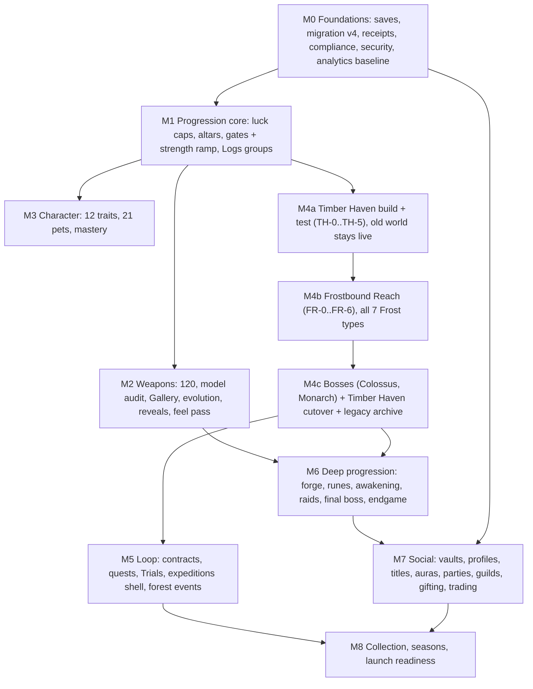

# Blade Forest — Master Game Completion Blueprint

**Status:** PROPOSAL for owner review. Read-only planning; nothing here is approved for construction.
**Date:** 2026-11-19 (PST). **Author:** Claude (executor). Planning partner: ChatGPT.
**Repository:** `hyperlykan99/Blade-Forest`. **Dev place:** 103379930563763 / universe 10777797608 (private). **Production:** 73142469975141 / universe 10777481912 (**protected**, untouched).

**Tags:**

- **[VERIFIED]** means read from the dev place (read-only, Edit mode, nothing saved), from scripts on `p1b2r/camera-visibility-fix` @ `d222d98`, or from committed docs.
- **[ESTIMATE]** means a model result.
- **[PROPOSAL]** means a design for approval.
- **[UNVERIFIED]** means an assumption to check before building.

### Sources integrated

| Source | Branch / commit | Used for |
| --- | --- | --- |
| Verified dev handoff (camera fix) | `p1b2r/camera-visibility-fix` @ `d222d98` | Baseline state, scripts, checkpoints |
| Crystal Wilds dense forest | `p1b2r/dense-forest` @ `a893300` | 620-tree layout, manifests, rollback tooling |
| Crystal Wilds build | `p1b2/crystal-wilds` @ `0fc997d` | Island build, BladeConfig/WorldServer changes |
| Timber Haven replacement | `proposal/timber-haven-redesign` @ `dfe5747` | 8-district design, cutover, rollback |
| Camera visibility research | `proposal/p1b2r-camera-visibility` @ `49e6e81` | Design behind the fix |
| Dense forest design | `proposal/p1b2-dense-forest` @ `63937f9` | Density rules |
| Main docs | `main` @ `25260c2` | Economy audit, M2 validation, P1b blueprint, asset manifest |

### Supporting files in this folder

| File | What it holds |
| --- | --- |
| [`sims/luck_logs_power_sim.py`](sims/luck_logs_power_sim.py) | Luck, Logs, Power, Divine-route and save-size model |
| [`sims/traits_and_gate_ramp_sim.py`](sims/traits_and_gate_ramp_sim.py) | 12-trait odds and the island strength-ramp check |
| [`sims/sim_output.txt`](sims/sim_output.txt) | Output of both scripts as committed |
| [`weapon_model_inspection.txt`](weapon_model_inspection.txt) | Read-only inspection of all 43 weapon models |

---

## 1. Summary

Blade Forest reaches feature-complete in **11 milestones (M0–M8, with M4 split into M4a, M4b and M4c)**. The order is:

1. Data safety.
2. The progression core, which every other system reads.
3. Content.
4. Social systems.
5. Long-term systems.

Today the game has 43 weapons, 6 traits, 7 pets, 2 built islands and a Frostbound placeholder. Of the 33 features on the definitive checklist (section 3), 1 is done, 20 are partial and 12 are missing. Systems that work today, such as rolls, upgrades and the index, count as partial when the approved scope extends them.

**Four findings shape the plan:**

1. **Saves are not safe enough for trading, vaults or high-value items** [VERIFIED]. They use `SetAsync` with no session lock, and receipts can be granted without a confirmed save. M0 fixes this first.
2. **Luck multiplies without limit** [VERIFIED formula, ESTIMATE times].
    - Today a heavy payer gets weapons about 36× faster than a free player on day 7.
    - The proposed caps cut this to 5–10×.
    - The proposal also cuts the top Logs stack from ×466 to ×112.
3. **New: the candidate island gates conflict with tree strength** [VERIFIED config].
    - M2 validation proposed entering Crystal Wilds at Power 60 and Frostbound at Power 500.
    - But Crystal Common trees need Power 250 and Frost Common trees need Power 2,000.
    - Below a tree's Strength, blades deal ×0.1 damage, so players would arrive unable to chop.
    - The plan sets each gate's Power floor to the next island's Common Strength.
    - It then guarantees a non-random weapon that reaches that floor (section 4.6).
4. **The old Frost Peaks region is the only home of the 7 Frost tree types** [VERIFIED]. Timber Haven's old world stays reachable until Frostbound Reach replaces it (M4c).

The decisions you need to make are listed in section 13.

---

## 2. Verified baseline (dev place)

| Item | State [VERIFIED] |
| --- | --- |
| Dev place version | **v18**: camera visibility fix (Studio-reported). **Checkpoint v16** = the pre-fix state. v17 is unexplained (not saved by Claude) |
| Production | `updateTime` 2026-11-18T15:12:30.520Z, unchanged (re-checked 2026-11-19 21:53 PST) |
| Crystal Wilds | **620 trees**, 620/620 at dense manifest spots, zones Z1–Z4 155/155/150/140 plus pockets P1–P4 of 5. All 7 Crystal tree types present. Rollback tooling and the exact pre-move snapshot are on `p1b2r/dense-forest` |
| Camera visibility fix | `ChopEffects` 27,331 B, Adler-32 1017905967. Canopy fade 0.90 (blocking) / 0.72 (near), with hysteresis. Tiered labels with a 16/24 cap; labels over the character are hidden. One Studio client, tests C1–C9 passed. **Rollback:** `ServerStorage.P1bBackups.ChopEffects_PreCameraFix` (18,500 B, 3640422855) or dev **v16** |
| Timber Haven (old world) | 4,401 trees (22,410 parts): Starter Grove 848, Pine 2,232, old Crystal Canyon 400, Frost Peaks 921. 980 map parts. Travel pads to both islands |
| Frostbound Reach | Placeholder: arrival floor, walls, label, return pad (8 parts) at (6000, 0, 0) |
| Scripts | 35 exported, checksum-matched on branches. `main` has no `src/` yet (no merge approved) |
| Save schema | `Version = 3`, one key per player, missing keys filled from defaults. Weapons stored as stacks per id |
| Untested | iPhone and two-player on the dev place |

---

## 3. Definitive feature checklist: implemented vs missing

**Status key:**

- **Done** = exists and is playable today.
- **Partial** = some of it exists.
- **Missing** = not built.

The *Milestone* column is where the remainder is built.

| # | Feature | Status | What exists [VERIFIED] | Remaining scope [PROPOSAL] | Milestone |
| --- | --- | --- | --- | --- | --- |
| F1 | Save safety (session lock, migrations, receipts) | Partial | `SetAsync` saves, reconcile on load, idempotent purchase ids | Session lock, v4 migration chain, confirmed-save receipts | M0 |
| F2 | Paid-random compliance | Partial | Odds shown; restriction checked on the client only | Server checks, true odds, trading policy | M0 |
| F3 | Security of imported assets | Missing | 14 suspicious ModuleScripts unreviewed | Review, quarantine, rate limits | M0 |
| F4 | Analytics and retention telemetry | Missing | — | Onboarding funnel, economy, progression and custom events | M0 (baseline), every milestone |
| F5 | Luck model and caps | Partial | Unlimited multiplicative luck | Groups, caps, tier exponents, true odds | M1 |
| F6 | Island gates and strength ramp | Partial | Power-only gates (legacy areas) | Checklist gates, Power floors, guaranteed weapon route | M1 |
| F7 | Logs groups and sink pricing | Partial | Multiplicative Logs; area-scaled prices | Grouped Logs, prices set in minutes of median income | M1 |
| F8 | Island altars | Missing | One global roll pool; `Config.Altars` unused | One 32-weapon pool per island | M1 |
| F9 | 120 weapons and acquisition | Partial | 43 weapons, rolls, Soul Shop, Starter Pack | 77 new weapons; boss, raid, Trials, forge, collection and season routes | M2, M6 |
| F10 | 3D weapon model audit | Partial | 43 models present; inspection done (section 9) | Fix or replace heavy models; source 77 | M2 |
| F11 | Weapon Gallery, favorites, collection | Partial | Index per area, rewards, Claim All | Gallery with 3D viewer, filters, favorites | M2 |
| F12 | Visual evolution, legendary reveals | Partial | Stars, Shiny, rarity trails, roll reveal, announcements | Tiered visuals and cinematic reveals | M2 |
| F13 | 12 traits with migration | Partial | 6 Logs traits, one slot, lock | 6 new traits, second slot, odds | M3 |
| F14 | Expanded pets, evolution | Partial | 7 pets, eggs, 3 slots | 21 pets, Golden and Rainbow evolution | M3 |
| F15 | Tree mastery, collectibles | Partial | Tree index, rewards, +5% Logs | 5 mastery levels per type, badges, titles | M3 |
| F16 | Timber Haven replacement | Missing | Old radial world | 8-district island, staged cutover | M4a, M4c |
| F17 | Crystal Wilds | **Done** (dev) | 620 dense trees, camera fix | Island boss (M4c), events (M5) | — |
| F18 | Frostbound Reach | Missing | Placeholder | Full island, 7 Frost types, boss, endgame hub | M4b |
| F19 | Island bosses | Partial | Blade King | Crystal Colossus, Frost Monarch | M4c |
| F20 | Quests, daily/weekly contracts | Partial | 5 daily, 4 weekly quests, streaks, achievements | Choice contracts, island quest chains | M5 |
| F21 | Chopping Trials | Missing | — | 60-s solo arena, ranks, tokens | M5 |
| F22 | Endless expeditions | Missing | — | Depth-based forest runs | M5 |
| F23 | Dynamic forest events | Partial | 3 server events, mutations | Island-local events | M5 |
| F24 | Materials, forging, runes, awakening | Missing | Fuse and Shiny only | Full deep-progression set | M6 |
| F25 | World raids, final boss, Frostbound endgame | Partial | Ancient Treant | 3-raid rotation, Heart of Winter | M6 |
| F26 | Vaults, profiles, titles, auras | Missing | Trait title, VIP tag | All | M7 |
| F27 | Parties, guilds | Missing | — | All | M7 |
| F28 | Gifting, trading | Missing | — | Gifting, then trading last | M7 |
| F29 | Collection milestones | Partial | Index area completion, achievements | Collection Score and milestones | M8 |
| F30 | Seasons | Missing | Codes only | Free track first | M8 |
| F31 | Fair monetization and purchase safety | Partial | 7 passes live; 9 products at `ProductId = 0` | Products created, caps applied, receipts safe, no paid power beyond caps | M0, M1, M8 |
| F32 | First-ten-minute onboarding | Partial | Tutorial controller | Redesigned around the Timber Haven village | M4a (with analytics from M0) |
| F33 | Premium chopping feel | Partial | Dense forests, camera fix, shake, logs, falling trees | Hit-stop, combo feedback, audio layers, mobile haptics | M2 (feel pass), polish |

---

## 4. Economic simulations and assumptions

**Method.** A Python model of the live roll and multiplier code, with inputs copied from BladeConfig.

- Hours assume auto-roll at 1.1 s per roll (free) or 0.6 s (Fast Roll, once its bug is fixed).
- The models are in `sims/`; results are **[ESTIMATE]**.
- The M2 gate times quote `docs/m2_sim_results.txt` on `main` (200 seeds, equal 45-minute sessions).

**Player types:**

| Type | Description |
| --- | --- |
| Free D1 | Upgrade luck about 1.5 |
| Free D7 | Upgrade luck about 3, 2 index areas, small pet luck, free Luck Potion running |
| Free max | All free sources maxed, no rebirth |
| Heavy payer | All passes, Mega Luck chained, Fast Roll |

### 4.1 Luck

| Player type | Current luck | Proposed luck |
| --- | --- | --- |
| Free, day 1 | ×2 | ×1.4 |
| Free, day 7 | ×15 | ×7.8 |
| Free, maxed | ×644 | ×25 |
| Heavy payer | ×309 | ×50 (cap) |
| Everything at once, plus Blood Moon | ×12,870 | ×50 (cap) |

The proposed rules are:

- Permanent luck (upgrade, rebirths, index, pets, group, Fortune Bark trait) adds up, capped at ×5.
- Only the strongest temporary boost counts (potion or event).
- The 2× Luck pass stays a true ×2.
- A hard cap of ×50 applies.
- Rarer tiers feel luck less: luck is raised to 0.9 for Legendary, 0.75 for Mythic, 0.6 for Secret and 0.5 for Divine.

**Heavy-payer speed-up vs a free player on day 7:**

| Tier | Current | Proposed |
| --- | --- | --- |
| Legendary | 36.1× | 9.7× |
| Mythic | 36.6× | 7.4× |
| Secret | 36.7× | 5.6× |
| Divine | 36.7× | 4.6× |

### 4.2 Time to first weapon of a tier, at one proposed island altar (hours of auto-roll)

| Player type | Legendary | Mythic | Secret | Divine |
| --- | --- | --- | --- | --- |
| Free, day 1 | 2.5 | 27 | 251 | rolling only: not realistic |
| Free, day 7 | 0.5 | 7.1 | 88 | rolling only: not realistic |
| Free, maxed | 0.2 | 3.0 | 44 | rolling only: not realistic |
| Heavy payer | 0.05 | 1.0 | 16 | about 1,200 |

**Deterministic Divine route.**

- Each roll gives 1 Altar Essence.
- A Divine forge recipe costs 100,000 Essence plus boss materials.
- That is about **31 h** of rolling for a free player and **17 h** with Fast Roll: a 1.8× gap.

### 4.3 Logs stack

| Stack | Current | Proposed |
| --- | --- | --- |
| Free, day 7 | ×3 | ×3 |
| Paid, day 7 (2× Logs, VIP, Log Boost) | ×12 | ×13 |
| Free maximum | ×106 | ×56 |
| Paid maximum | ×466 | ×112 |
| Paid maximum with 10 rebirths | ×1,630 | ×112 |

The proposed rules are:

- Trait, rebirth, index, mastery and guild bonuses add up, capped at +600%.
- Pets add up, capped at +300%.
- Only the strongest temporary boost counts.
- The 2× Logs pass stays.
- The PvP Logs bonus becomes Souls only.

### 4.4 Power per weapon

- Today the ceiling is ×3.75 the base (star ×2.5, Shiny ×1.5).
- Proposed: awakening adds up to ×1.6, for a **ceiling of ×6.0**.
- Runes, forging, traits and guilds never raise Power.
- Owned weapons never lose Power: the 43 legacy values are frozen.

### 4.5 Traits (12)

The existing weights are kept and the new traits are added, so each old trait keeps its relative share.

| Trait | Old odds | New odds | Effect |
| --- | --- | --- | --- |
| Sapling | 50.00% | 39.37% | +25% Logs |
| Woodcutter | 28.00% | 22.05% | +50% Logs |
| Swift Feet | — | 7.87% | +15% walk speed |
| Lumberjack | 14.00% | 11.02% | +75% Logs |
| Keen Edge | — | 4.72% | +20% blade damage |
| Soul Reaper | — | 4.72% | +50% Souls |
| Timber Titan | 6.00% | 4.72% | +100% Logs |
| Mutation Hunter | — | 2.36% | +50% Logs from mutated trees |
| Forest Warden | 1.80% | 1.42% | +150% Logs |
| Beastmaster | — | 0.79% | Pet bonuses +25% |
| Fortune Bark | — | 0.79% | +0.3 permanent Luck |
| Ancient Root | 0.20% | 0.16% | +200% Logs |

- The expected Logs bonus of one crate drops from +46% to +36%, because some rolls now give non-Logs traits.
- Ancient Root becomes 1 in 635 (was 1 in 500). The median number of crates to a first Ancient Root is 440.
- With 2 slots (no duplicates), the best trait pair gives +350% Logs. That fits inside the +600% permanent cap together with the other permanent sources.
- Soul crate weights get the same treatment.
- Lucky Crates still doubles the weight of every trait at Lumberjack and above (and the new traits at Rare and above).

### 4.6 Island gates and the strength ramp

| Island | Candidate arrival Power (M2) | Common tree Strength | Result |
| --- | --- | --- | --- |
| Crystal Wilds | 60 | 250 | ×0.1 damage on every tree |
| Crystal Wilds | 250 (legacy gate, live on dev) | 250 | Full damage |
| Frostbound Reach | 500 | 2,000 | ×0.1 damage on every tree |
| Frostbound Reach | 2,000 (legacy gate) | 2,000 | Full damage |

**[PROPOSAL] Gates:**

- **G2 (Crystal Wilds):** 600 trees + Blade King defeated + Power ≥ 250. The Blade King's guaranteed first-kill drop is a weapon with fixed Power 250.
- **G3 (Frostbound Reach):** 6,000 Crystal Wilds trees + Crystal Colossus defeated + Power ≥ 2,000. The Colossus's guaranteed first-kill drop has fixed Power 2,000.

Luck only speeds this up; it never decides it. From M2 validation, "trees + Power 2,000" left 14% of free players short of Island 3 after 20 hours when Power came only from luck. The guaranteed drop removes that tail.

**[UNVERIFIED]** The model must be re-run with the guaranteed drops before M1 build.

### 4.7 Island pacing targets (to verify by simulation in M1)

| Step | Target (free player) | Evidence so far |
| --- | --- | --- |
| First chop | < 30 s | Timber Haven design puts trees 25 studs from spawn |
| Pinewood gate (Power 40) | 4–6 min | Today about 4 min [ESTIMATE] |
| Crystal Wilds | 20–30 min | M2 model: 22 / 23 / 25 min (p10 / p50 / p90) [ESTIMATE] |
| Frostbound Reach | 4–8 h | M2 model with a tree checklist: 3.5–4.1 h at Power 500. To be re-run at Power 2,000 with the guaranteed drop |
| First Divine (forge) | about 30–40 h | Section 4.2 |
| Feature-complete endgame | Open-ended | Weekly boss, raids, expeditions, Trials, seasons |

### 4.8 Save size

The full 120-weapon collection with stars, awakening, three rune slots and favorites is about 13 KB. A full profile is under 60 KB, against the 4 MB DataStore limit. Concurrency is the risk, not size.

---

## 5. Islands

### 5.1 Timber Haven: complete replacement (M4a, M4c)

Full design: `docs/proposals/timber_haven/TIMBER_HAVEN_REDESIGN.md` on `proposal/timber-haven-redesign` @ `dfe5747`.

**What it is:**

- 8 districts on 760 × 640 studs, built at a staging center of (0, 0, −3000): Haven Village, Crafters' Plaza, Collectors' Row, Sapling Woods, Pinewood Hollow, Elderpine Ridge, Kingsfall Arena and Portal Cliffs.
- About 1,200 trees, every one stamped with its legacy `Area` (StarterGrove or PineForest).
- A `TimberHavenLayout` config table and a `"legacy"`/`"v2"` flag drive `GetAreaAt`, the safe zone, the arena, the Treant, slime zones and the island `Arrival`.

**Integration rules for this master plan:**

1. **District coordinates and tree counts are provisional.** They are confirmed by the M1 economy re-run (income per district) and a TH-1 terrain walk test on iPhone.
2. **The old world stays reachable until Frostbound Reach replaces it.** TH-0 to TH-5 (build and test) happen in M4a.
    - Cutover (TH-6) is part of **M4c**, after Frostbound Reach carries all 7 Frost types.
    - If the owner wants an earlier cutover, Portal Cliffs gets a temporary "Frost Peaks (legacy)" pad to the old region.
3. Nothing is deleted at cutover. Old objects go to `ServerStorage.LegacyTimberHaven`, and rollback means flipping the flag back.

### 5.2 Crystal Wilds: preserve (done on dev)

- **Preserve exactly:**
    - all **620 trees** at their dense spots;
    - zones Z1–Z4 and pockets P1–P4;
    - the plaza and return pad;
    - the Golden Slime zone.
- **Preserve the camera fix:** `ChopEffects` 27331:1017905967, its rollback backup script, and dev **v16** as the rollback checkpoint.
- **Every later milestone that touches the place must check:**
    - 620/620 trees still match `docs/p1b_tree_spots_crystal_wilds.csv` within 0.06 studs;
    - the ChopEffects checksum still matches its branch.
- **Still to add to Crystal Wilds:**
    - Crystal Colossus boss and arena (M4c);
    - Crystal Bloom event (M5);
    - Trials arena slot (M5);
    - B1 respawn effect drift fix (backlog).

### 5.3 Frostbound Reach: complete construction (M4b) [PROPOSAL]

**Footprint.** Center (6000, 0, 0), 640 × 560 (x 5680–6320, z −280–280), inside the registry bounds 5660–6340 × −320–320. Arrival moves to (5750, 5, 0).

**Districts.**

| District | Center (x, z) | Purpose | Tree types (all 7 Frost types) |
| --- | --- | --- | --- |
| Frostgate Outpost | (5750, 0) | Arrival, return pad, stations, Forge annex, requirement board | — |
| Snowfield | (5880, 120) | Entry forest, dense | Frost_Common (Snow Spruce), Frost_Uncommon (Glacier Pine) |
| Glacier Pass | (5900, −140) | Mid forest | Frost_Rare (Frostwood), Frost_Epic (Aurora Tree) |
| Aurora Basin | (6080, 60) | Advanced forest on the legacy snow-hill core | Frost_Legendary (Starfrost Tree), Frost_Mythic (Frostleaf Tree) |
| Giant's Hollow | (6200, 190) | Rare-spawn hollow | Frost_Secret (Ancient Frost Giant), plus the other types |
| Monarch's Throne | (6150, −180), radius 48 | Frost Monarch island boss | — |
| Heart of Winter Sanctum | (6250, −40) | Final boss, parties of 1–4, key entry | — |
| Expedition Gate | (6280, 60) | Endless expeditions portal. The Island 4 pad slot stays reserved at (6240, 200) | — |

**Trees.** About 830 trees in dense zones, using the legacy weights per type (Common 55, Uncommon 25, Rare 13, Epic 5.5, Legendary 1.5, Mythic 0.5, Secret 0.1). Every tree is stamped `Area = FrostPeaks`, so tree index, prices and achievements are unchanged.

**Frost tree index check:** all 7 types must be present and choppable before the old Frost Peaks region is archived.

**Budget actions:**

- Replace or cap the 370-part `Frost_Mythic_1` with a Creator Store asset.
- Limit lights and particles to Legendary+ trees and Shadow/Rainbow mutations (decision B1).

**Boss progression.**

1. The Blade King (Timber Haven) gives the G2 guaranteed weapon and Bark sigils.
2. The Crystal Colossus (Crystal Wilds) gives the G3 guaranteed weapon and Crystal sigils.
3. The Frost Monarch (Frostbound Reach) gives Frost sigils, 2 boss weapons and runes.
4. One sigil from each boss forges a **Winter Key**.
5. The Heart of Winter (final boss) has its first clear each week rewarded per player. It drops 2 Divine weapons, auras and titles.

**Endgame hub.** Frostbound holds all the repeatable endgame:

- the weekly final boss;
- the Frost raid in the rotation;
- the expedition gate;
- the Trials Diamond rank;
- the awakening III materials (Frost Cores);
- full mastery.

**Construction stages (each with approval, checkpoint and handoff, like P1b):**

| Stage | Work |
| --- | --- |
| FR-0 | Checkpoint, asset shortlist |
| FR-1 | Terrain (paste and extend the legacy snow-hill core) |
| FR-2 | Tree manifest, dry run and placement |
| FR-3 | Outpost and stations |
| FR-4 | Monarch arena and sanctum shells |
| FR-5 | Tests: all 7 types, travel, camera fix, budgets, iPhone |
| FR-6 | Dev save and handoff |

---

## 6. Weapons, collection and deep progression

### 6.1 The 120-weapon collection [PROPOSAL]

| Source | Timber Haven | Crystal Wilds | Frostbound Reach | Total |
| --- | --- | --- | --- | --- |
| Island altar (roll) | 32 (25 existing + 7 new) | 32 (10 + 22) | 32 (4 + 28) | 96 |
| Island boss drops (incl. guaranteed gate weapons) | 2 | 2 | 2 | 6 |
| World raids | — | — | — | 3 |
| Final boss | — | — | 2 | 2 |
| Chopping Trials | — | — | — | 3 |
| Forge recipes (incl. 2 Divine) | — | — | — | 3 |
| Collection milestones | — | — | — | 2 |
| Season | — | — | — | 1 |
| Existing exclusives (Starter Pack, 3 Soul Shop) | — | — | — | 4 |
| **Total** | | | | **120** (43 existing + 77 new) |

**Rarity mix per altar:**

| Altar | C | U | R | E | L | M | S | D |
| --- | --- | --- | --- | --- | --- | --- | --- | --- |
| Timber Haven | 5 | 5 | 6 | 5 | 4 | 3 | 3 | 1 |
| Crystal Wilds | 5 | 5 | 5 | 5 | 4 | 4 | 3 | 1 |
| Frostbound Reach | 4 | 4 | 4 | 5 | 5 | 4 | 2 | 4 |

Every rarity has at least 5 weapons across the game.

- **Power:** new weapons get 5 × OneIn^0.45 × island multiplier (1 / 4 / 16). Legacy Power is frozen.
- **Altars:** each island altar rolls only its own pool; players roll at any unlocked island.

**Weapon types.** Swords, axes and scythes as today. A model must read clearly as one of the three.

### 6.2 Gallery, favorites, collection, visual evolution, reveals

- **Gallery:**
    - Shows all 120 slots, with undiscovered weapons as silhouettes.
    - Filters by island, rarity, type, owned and favorite.
    - Each weapon has a 3D viewer, stats and a hint on how to get it.
- **Favorites** block sell, fuse, salvage and trade.
- **Visual evolution:**

    | Level | What changes |
    | --- | --- |
    | Star 3 | Edge glow |
    | Star 5 | Trail |
    | Shiny | Shimmer |
    | Awakening I–III | Aura rings |

- **Reveals:**

    | Tier | Reveal | Length | Announcement |
    | --- | --- | --- | --- |
    | Legendary | Gold burst | 1.5 s | — |
    | Mythic | Beam | 2.5 s | — |
    | Secret | Rainbow | 3 s | Server |
    | Divine | Cinematic | 4 s | Global |

    Skip Reveals and Reduced Motion are respected.

### 6.3 Materials, forging, runes, awakening

- **Materials:**
    - Bark (Timber Haven), Crystal Shards (Crystal Wilds) and Frost Cores (Frostbound Reach), from trees.
    - Boss sigils.
    - Altar Essence (1 per roll).
- **Forge:**
    - Salvage duplicates into Essence.
    - Craft the 3 recipe weapons, including the Divine route.
    - Craft the Winter Key.
    - Reroll runes.
- **Awakening:** a ★5 weapon plus materials gives I, II and III, for Power ×1.2, ×1.4 and ×1.6, an aura and one rune slot per level.
- **Runes:**
    - Types: Logs %, damage %, Souls %, permanent Luck and mutation Logs, in 4 rarities.
    - They come from raids and expeditions.
    - Rune effects count in their stacking groups.

---

## 7. All other approved features [PROPOSAL]

| Feature | Design | Stacking group | Milestone |
| --- | --- | --- | --- |
| Expanded pets | 21 pets (7 per island egg). Evolution: 3 → Golden ×1.5; 3 Golden → Rainbow ×2. 3 slots, VIP +1 | Pets (Logs cap +300%); permanent Luck | M3 |
| Tree mastery | 5 levels per tree type (25 / 100 / 500 / 2,000 / 10,000 chops), +0.5% Logs each. Badges at levels 3 and 5. A title when an island is fully mastered. Mutation mastery | Permanent Logs | M3 |
| Quests | 10-step chain per island, leading to its gate | — | M5 |
| Daily and weekly contracts | Pick 3 of 5 daily and 2 of 4 weekly. Island-aware. Streaks kept. They replace fixed quests | Rewards only | M5 |
| Chopping Trials | 60-s solo run in a per-player arena slot. Bronze to Diamond ranks. Weekly leaderboard. Trial Tokens buy 3 Trial weapons | — | M5 |
| Endless expeditions | Numbered depths from the Frostbound gate, built from existing tree templates. Depth leaderboard. Materials and runes | — | M5 (shell), M6 (rewards) |
| Dynamic forest events | Crystal Bloom, Blizzard, Meteor Grove, plus the existing 3 | Temporary (strongest only) | M5 |
| World raids | Treant (Timber Haven), Crystal Hydra (Crystal Wilds), Frost Giant (Frostbound) on a 20-min rotation. Damage-share rewards. 3 raid weapons | — | M6 |
| Final boss | Heart of Winter: Winter Key entry, parties of 1–4, weekly first clear | — | M6 |
| Parties | 2–4 players; shared boss and expedition entry; no stat bonus | — | M7 |
| Guilds | Up to 30 members. Guild level, weekly guild contract. Cosmetic perks plus at most +10% Logs. Own DataStore keys; MemoryStore across servers | Permanent Logs | M7 |
| Gifting | Buy a pass or product for a player in the same server; same confirmed-save receipt path | — | M7 |
| Trading | In-server, two players, weapons and pets only, no currency. Both confirm, then a 5-s countdown. Favorites and vault excluded. `IsPaidItemTradingAllowed` checked on the server. Atomic session-locked writes with a trade id, and a trade log | — | M7 (last) |
| Player vaults | 6 showcase slots plus protected storage | — | M7 |
| Profiles, titles, auras | Profile card. One title shown over the head. Cosmetic auras only | None (cosmetic) | M7 |
| Collection rewards | Collection Score across weapons, trees, pets, mastery and titles. Milestones at 10 / 25 / 50 / 75 / 100%, with weapons at 50% and 100% | Rewards only | M8 |
| Seasons | 6–8 weeks, free track earned with contract points. Season items kept. Leaderboards reset | Within caps | M8 |

---

## 8. Growth and monetization [PROPOSAL]

### 8.1 Premium chopping experience

Satisfying, nonstop multi-tree chopping is the core priority.

**Already done:**

- dense forests (Crystal Wilds, and Timber Haven and Frostbound by design);
- the camera fix;
- falling trees and log pops.

**To add, in M2 as a "feel pass" kept small:**

- a 40–60 ms hit-stop on Rare+ fells;
- a chop combo counter for fells within 1.5 s, which only shows a number with no stat effect;
- layered chop audio by tree rarity;
- haptics on mobile.

All of it follows the Screen Shake and Reduced Motion settings.

### 8.2 First-ten-minute onboarding

Based on the Timber Haven journey:

| Time | Step |
| --- | --- |
| 0:20 | First chop |
| 1:30 | +1 Blade |
| 2:30 | First rolls |
| 4:00 | Trait and egg |
| 5:00 | Pinewood gate |
| 8:30 | Arena sighting |
| 9:30 | Portal board |

Each step is logged as an onboarding funnel step.

### 8.3 Retention analytics (M0 baseline, extended each milestone)

Uses Roblox `AnalyticsService`.

- **Onboarding funnel:** `LogOnboardingFunnelStepEvent` for the 10 steps above.
- **Recurring funnels:** `LogFunnelStepEvent` for the shop funnel, egg hatch and trade.
- **Economy:** `LogEconomyEvent` for every source and sink of Logs, Souls, Essence and materials.
- **Progression:** `LogProgressionEvent` for island gates, bosses and expedition depth.
- **Custom:** `LogCustomEvent` for reveal skips, Trials scores and similar.

**Targets** (owner to confirm):

- D1 retention ≥ 25%;
- D7 ≥ 8%;
- 80% of new players chop within 30 s;
- 60% reach the Pinewood gate in session 1;
- 35% reach Crystal Wilds by D1.

### 8.4 Free-to-play progression

- Every gate, weapon tier and endgame activity is reachable without paying.
- Paid boosts shorten time but never decide access.
- Free players keep guaranteed routes: the gate weapons, the Divine forge, Trials weapons and season items.
- **Target:** a heavy payer is at most 10× faster than a free player on day 7 on any weapon tier (section 4.1). Payer time to Frostbound is within 2× of a free player's.

### 8.5 Fair monetization

Keep:

- the 7 passes, with their effects kept inside the caps;
- the cosmetic and convenience products.

Create the 9 developer products only after M0 receipts are safe.

**Rules:**

- No paid item grants Power above the caps.
- The Mega Luck potion is held to the ×50 cap (decision D1).
- Log packs scale with the player's island and are capped at 60 minutes of median income.
- Paid random items show all odds and true luck-adjusted odds, and are blocked server-side for restricted players.
- No paid trading currency.

### 8.6 Purchase safety

1. `PurchaseGranted` only after a confirmed save.
2. Idempotent purchase ids, pruned after 60 days.
3. Session-locked saves.
4. Server-side ownership checks (already present for passes).
5. Gifts use the same path.
6. A purchase log in analytics.
7. Test each product end to end in the dev place before production.

---

## 9. Asset manifest and 3D weapon inspection

### 9.1 Weapon models [VERIFIED read-only inspection; full table in `weapon_model_inspection.txt`]

**Inventory:**

- 43 models for 43 weapons; none missing, no orphans.
- **0 scripts** in any model.
- 0 collidable parts; all anchored; all normalized to 4.0 studs long.
- No model sets a PrimaryPart.
- 30 of 43 are a single part.

**Heavy models**, which are multiplied by up to 7 blades × 20 players:

| Model | Parts |
| --- | --- |
| Sunsteel Sword | **144** (6 unions) |
| Founder's Edge | 59 |
| Bonewhite Reaper | 41 |
| Glacier Fang | 19 |
| Prism Saber | 16 |
| Soulbound Blade | 15 |
| Warlord Axe | 13 (13 SurfaceAppearances) |
| Wooden | 13 |

**Effects built into models** (also multiplied per blade):

| Model | Effects |
| --- | --- |
| Shadow Katana | 8 emitters, 1 light |
| Forsaken Axe | 4 emitters, 1 light, 1 trail |
| Soulfire Scythe | 2 emitters, 2 lights |
| Sunsteel Sword | 1 emitter, 1 light |
| Frost | 1 light |
| Venomfang Axe | 1 light |
| Ronin Katana | 3 trails |
| Starfall Reaper | 1 trail |

Triangle counts cannot be read from Luau. They must be checked in the Creator Store listing or Studio statistics.

**Findings → actions (M2):**

| Finding | Action |
| --- | --- |
| Models over 8 parts | Replace with a single-mesh Creator Store model of the same name and look, or bake (merge) where the license allows |
| Lights inside blade models | Remove. Rarity lighting moves to the existing BladeEffects system, which can cap total lights per player |
| Emitters inside blade models | Cap at 2 per model, active only on the equipped blade's first copy |
| No PrimaryPart | Set a grip PrimaryPart when re-sourcing (needed for the Gallery viewer) |

### 9.2 Inspection standard for all 120 weapons

Each weapon is checked for:

- Creator Store asset id, creator and license;
- ≤ 8 parts or 1 mesh;
- ≤ 4,000 triangles;
- 0 scripts;
- ≤ 2 emitters and 0 lights;
- 4 studs long, grip at the pivot;
- a silhouette readable at 1.5 studs;
- one style family per island;
- the right type (sword, axe or scythe).

Results are logged in `docs/weapon_manifest.json` (to be created in M2).

### 9.3 World asset manifest (Creator Store unless noted)

| Island | Assets |
| --- | --- |
| Timber Haven | Village kit, forge, Gallery hall, pet sanctuary, trait shrine, stations, 2 gate arches, 4 portal frames, landmarks. Reuse trees, camps, leaderboards and the arena (TH report §6) |
| Crystal Wilds | Colossus rig, arena ring, Trials arena dressing |
| Frostbound Reach | Outpost kit (snow variant), Monarch rig, Heart of Winter rig, sanctum, expedition gate, replacement for `Frost_Mythic_1` |
| Pets | 14 new pet models (7 Crystal, 7 Frost) |
| Raids | Crystal Hydra and Frost Giant rigs |
| UI | Gallery, contract, Trials and season icons (Creator Store decal packs) |

Every pick follows the P1b rule: log id, creator and license; check for scripts before insertion.

---

## 10. Performance and mobile constraints

| Budget while standing on an island | Limit [PROPOSAL] | Today [VERIFIED] |
| --- | --- | --- |
| Tree BaseParts | ≤ 7,000 (Crystal Wilds, Frostbound); ≤ 9,000 (Timber Haven) | Crystal Wilds 4,953; old Timber Haven 22,410 |
| Other BaseParts | ≤ 3,000 | Old Timber Haven 980 |
| Lights | ≤ 40 | Crystal Wilds 37 enabled |
| Particle emitters | ≤ 150 | Crystal Wilds 135 |
| Max parts per tree | ≤ 40 | `Frost_Mythic_1` is 370 |
| Blade model parts | ≤ 8 | Up to 144 |
| Blade lights | 0 | 7 models have lights |

**Rules:**

- Streaming stays on.
- The camera fix stays: fade at about 11 Hz, labels at about 3 Hz, no leaks.
- Labels are capped at 16 compact / 24 large.
- Every milestone has an iPhone check. **MacBook Studio frame rates are never used as iPhone evidence.**
- Two-device multiplayer tests replace multi-client Studio runs.
- Server: AutoChop and blade hit checks stay server-side. Keep heartbeat work under 2 ms per player at 20 players [UNVERIFIED target].

---

## 11. Save compatibility and rollback requirements

### 11.1 Save rules (every milestone)

1. Old fields are never removed or renamed: `Logs`, `Souls`, `Weapons`, `Equipped`, `BestArea`, `UnlockedIslands`, `LastIsland`, `Trees`, `TreeClaimed`, `TreeIndexDone`, `IndexDone`, `Achievements`, `Purchases`, `Trait`, `Pets`, `Rebirths` and every other key in `DEFAULT`.
2. **v4 migration chain** (M0):
    - numbered steps, each run once;
    - a backup key written before each step;
    - a failed step leaves the old save intact.
3. Weapon ids, tree type ids and legacy area ids are permanent.
4. **Weapon identity** (decision D3): plain copies stay stacked. Awakened or runed weapons become items with an id in a new `WeaponItems` table. The stack is untouched.
5. **Traits:** the existing `Trait` stays; the second slot is a new `Trait2`. No migration is needed.
6. **Pets:** the existing counts stay; evolution adds `PetGolden` and `PetRainbow` counts.
7. **Island data** keeps using `UnlockedIslands`. Gates add `IslandProgress` counters (already reserved).
8. Every milestone runs the **save diff test**: load at least 5 real dev saves before and after, and diff them. Only intended additions are allowed.

### 11.2 Rollback (every milestone)

- **Before any write:** assert the dev place and universe ids, save a dev checkpoint, tag git and keep a script backup in `ServerStorage.P1bBackups`.
- **Rollback order:**
    1. Flip the feature flag (Timber Haven layout, luck model, altars).
    2. Restore the backup script.
    3. Revert to the checkpoint version.
- No rollback ever resets or edits a player save.
- **Production:** frozen until owner decision D8. The first production change will be one rehearsed migration on a copy, with a documented rollback.

### 11.3 Standing checkpoints

| Checkpoint | Version / file |
| --- | --- |
| Pre-camera-fix | dev **v16**; `ChopEffects_PreCameraFix` (18500:3640422855) |
| Pre-dense-redistribution | dev **v14**; `P1b2r_PreMoveSnapshot`; `tools/p1b2r_dense_redistribution/rollback.luau` |
| Pre-Crystal-Wilds | dev **v9** |

---

## 12. Construction sequence and dependencies

**Dependency rules:**

- M2, M3 and M4a can run side by side after M1.
- Trading (M7) needs session locks (M0) and weapon identity (M6).
- The final boss (M6) needs boss sigils (M4c).
- Contracts (M5) need gates (M1) and all three islands (M4c).

**Every milestone follows the same steps:**

1. Owner approval.
2. Dev checkpoint.
3. Feature branch.
4. Build.
5. Acceptance tests (section 14).
6. iPhone check.
7. Dev save.
8. Handoff.
9. Owner review.

Only one AI edits Studio at a time.

---

## 13. Owner decisions needed before implementation

| # | Decision | Recommended default | Needed by |
| --- | --- | --- | --- |
| D0 | This document is the full approved scope | Yes | Approval |
| D1 | Luck caps (permanent ×5, hard ×50, tier exponents). Keep the paid Mega Luck potion? | Approve. Keep Mega Luck, held to the cap | M1 |
| D2 | One altar per island; legacy Power frozen | Yes | M1 |
| D3 | Stacked copies plus individual items for awakened or runed weapons | Yes | M0 schema |
| D4 | ProfileStore (open-source session lock) or our own `UpdateAsync` lock | ProfileStore | M0 |
| D5 | Trading allowed? Limits as in section 7 | Yes, last | M7 |
| D6 | Paid season track | Free track first | M8 |
| D7 | Second trait slot on Frostbound | Yes | M3 |
| D8 | When production changes | Frozen until M4c; then one rehearsed migration | First production change |
| **D9 (new)** | Gate Power floors = next island's Common Strength (250 / 2,000), with guaranteed boss-drop weapons. The alternative is re-tuning tree Strength | Floors plus guaranteed drops | M1 |
| T1 | Timber Haven cutover before Frostbound? | No: cut over in M4c | M4a |
| T2 | Keep the new Timber Haven at (0, 0, −3000) | Yes | M4a |
| B1 | Glow (lights and particles) only on Legendary+ trees and Shadow/Rainbow mutations | Yes | M4a / M4b |

---

## 14. Acceptance criteria

### 14.1 Per milestone (all must pass; recorded in the handoff)

**Every feature must also pass:**

- a one-client Studio test;
- an iPhone check once it is visible to players;
- no new console errors;
- the save diff test;
- server-side validation of every remote;
- the economy model re-run.

| Milestone | Criteria |
| --- | --- |
| M0 | No lost or duplicated write in 50 forced cross-server join/leave cycles; the lock expires within 30 min of a crash. A v3 save loads into v4 with every field intact. Receipts are granted only after a confirmed save, with no double grant on retry. A restricted test player cannot open any paid random item on the server. The 14 suspicious scripts are resolved. The analytics onboarding funnel is visible in the Creator Dashboard |
| M1 | Luck matches the formula for every player type, with caps enforced on the server. The altar panel shows true odds. Each altar rolls only its pool. Gates check trees, boss and Power, and say which part is missing. The guaranteed gate weapons drop once. Free p90 time to Frostbound is under 20 h in the re-run model |
| M2 | 120 weapons are in config, each with source, rarity, Power and a model passing the inspection standard. Every rarity has 5 or more. Gallery and favorites work and persist. Visuals and reveals match tiers. The feel pass respects settings |
| M3 | Old traits keep id and value. Shown odds match a 100,000-roll test within 0.5 points. 21 pets in 3 eggs, and evolution consumes exactly 3. Mastery thresholds work. Everything stays within group caps |
| M4a | Timber Haven TH-5 test list passes (TH report §8) with the flag on `"v2"` in a playtest. The legacy layout is unchanged with the flag on `"legacy"` |
| M4b | Frostbound Reach is built. All 7 Frost types are choppable. Budgets are met. Travel works both ways. The camera fix works. iPhone check passes |
| M4c | Colossus and Monarch spawn, scale and pay by damage. Timber Haven cutover is done, the save diff is clean, and the old world is archived. Crystal Wilds still has 620/620 trees and the camera fix checksum matches |
| M5 | Contracts reset on the server clock. Quest chains complete. Trials slots spawn and clean up, with server scoring. Expedition depths generate and scale. Events follow the strongest-boost rule |
| M6 | Recipes consume exact inputs. Awakening ≤ ×1.6. Rune slots follow awakening level. Raids rotate. Winter Key is consumed once. Weekly first clear is tracked. Parties of 1–4 work |
| M7 | Showcase visible to others; vaulted items protected. Guild data consistent across 2 servers. Gift granted exactly once. 1,000 scripted trade attempts, including mid-trade disconnects, produce no duplicate or lost item. Paid-trading policy enforced |
| M8 | Collection Score is computed only from saved data. Season start and end follow the server clock, and season items are kept. Production migration rehearsed on a copy. iPhone and two-device tests pass. Owner sign-off |

### 14.2 Declaring Blade Forest feature-complete

The game is feature-complete when **all** of these hold on the dev place:

1. Every row F1–F33 in section 3 is **Done**.
2. M0–M8 acceptance criteria have passed and are recorded in `docs/LIVE_HANDOFF.md`.
3. 120 weapons pass the inspection standard. 3 islands, 3 island bosses, 3 raids and the final boss are playable from a fresh save to the weekly endgame without paying.
4. The economy model shows these with the final config:
    - free p50 to Crystal Wilds ≤ 30 min;
    - free p90 to Frostbound ≤ 20 h;
    - heavy-payer speed-up ≤ 10× on every weapon tier;
    - a first Divine reachable free in ≤ 40 h.
5. All budgets in section 10 are met and an iPhone session of 30 minutes runs without crashes.
6. A save made at v3 loads, plays and saves correctly at the final version. A rollback rehearsal restores the previous version without touching saves.
7. No open item remains in the must-fix list (section 15.1).

---

## 15. Must-fix list and backlog

### 15.1 Must-fix (security, data loss, progression blocking — never deferred)

| Issue | Type | Milestone |
| --- | --- | --- |
| `SetAsync` with no session lock | Data loss | M0 |
| `PurchaseGranted` before a confirmed save | Data loss (paid) | M0 |
| 14 suspicious imported ModuleScripts | Security | M0 |
| Paid-random restriction is client-only | Policy | M0 |
| Shown odds for common weapons about half the real odds | Policy (disclosure) | M1 |
| Unlimited luck stacking | Progression | M1 |
| Candidate gates below tree Strength (new) | Progression blocking | M1 |
| Frost tree index lost if old Frost Peaks is retired early | Progression blocking | M4b/M4c order |

### 15.2 Backlog (nonblocking bugs and polish)

| Item | When |
| --- | --- |
| Fast Roll auto interval 0.4 s vs server limit 0.51 s | M1 |
| Dead `Pity`, `Areas[].RollCost`, `GetRollOdds` config | M1 |
| Playtime gifts reset on rejoin | M5 |
| `d.Purchases` grows without limit | M0 |
| B1: respawned Crystal Wilds trees lose tags and reroll effects | M4c |
| Golden Slime zones share one cap (resolved by Timber Haven rebuild) | M4c |
| Dense Crystal Wilds income about 4× | M1 pricing |
| `leaderstats` infinite-yield warnings (AFKController:34, PvPSoulController:156) | Polish |
| Starbreaker (Secret, Power 3,008) in the starter pool (resolved by altars) | M1 |
| 24-label cap on large screens not verified | M2 |
| Dev place v17 version gap unexplained | Before M0 |
| Blade models without PrimaryPart | M2 |
| Landmarks and decorative dressing on all islands | Polish (after feature-complete) |
| Music per island, ambient audio | Polish |
| Reveal and Gallery animation tuning | Polish |

---

## 16. What this document does not do

It does not:

- approve any construction;
- change Studio, scripts, saves or production;
- merge any branch.

Each milestone still needs its own owner approval, starting with M0.
