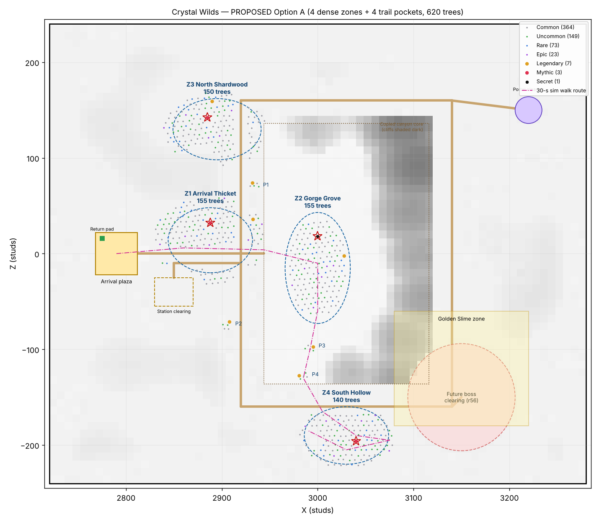

# Blade Forest — P1b.2 Crystal Wilds Dense-Forest Redesign (PROPOSAL)

**Status:** design only. Nothing in Roblox has changed.
- No trees, terrain, scripts or data were changed, nothing was saved, and nothing was published.
- The dev place (103379930563763 / 10777797608) was inspected **read-only** after asserting PlaceId and GameId: attribute reads and raycasts only.
- Production was not touched.
- The working manifest `docs/p1b_tree_spots_crystal_wilds.csv` (branch `p1b2/crystal-wilds`) is **unchanged**.

**Date:** 2026-11-19. **Branch:** `proposal/p1b2-dense-forest`. **Author:** Claude (for owner review).

**Labels used throughout:**

| Label | Meaning |
|---|---|
| **[SOURCE]** | Read from the committed scripts (`p1b2/crystal-wilds` @ `0fc997d`) |
| **[MEASURED]** | Read from the dev place in Studio (read-only) |
| **[SIM]** | Python simulation that ports the server hit-detection code. **Estimate, not a playtest** |
| **[PROPOSAL]** | Design recommendation |

---

## 0. Summary

**Root cause [MEASURED].** Crystal Wilds trees average **12.0 studs** to their nearest neighbour. The live game's own forests are 4–6 studs:

| Forest | Nearest-neighbour distance |
|---|---|
| Starter Grove | 4.6 |
| Crystal Canyon | 5.0 |
| Pine Forest | 6.1 |
| Frost Peaks | 6.0 |
| **Crystal Wilds (current)** | **12.0** |

The P1b.2 spot rule ("canopies must not overlap") produced an exploration island, not a chopping forest. An entry-level Crystal player's blades reach about **1.2** other trees from a typical tree position, against **8.8** in the live Crystal Canyon.

**Hit detection is not the limit [SOURCE + MEASURED].**
- Every tree has exactly **one** queryable part: an invisible box hitbox about 2.4 studs wide (Secret about 4.3).
- **No tree part collides with players.** Density cannot block movement, AutoChop pathing or NPCs.
- Blades are an orbiting **annulus**. The player hits every tree whose hitbox lies in the ring, so trees per sweep scale directly with local density.

**Recommendation [PROPOSAL]: Option A.**
- Redistribute the same 620 trees into **4 dense zones plus 4 five-tree trail pockets**.
- Hex lattice 6 studs, nearest-neighbour about **5.2**: the same spacing as the live Crystal Canyon, packed into compact zones.
- Every zone is next to the plaza and paths, and the far east (boss clearing, Golden Slime meadow, portal) stays open.

**Effect on chopping, trees hit per blade revolution [SIM]:**

| Profile | Current | Option A | Option B |
|---|---|---|---|
| Crystal entry | 1.8 | **13.7** | 23 |
| Midgame | 3.0 | **22.6** | 36 |
| High | 5.7 | **38.8** | 59 |

Walking the same 30-second route, an entry player touches **185** trees under A, against **31** today.

**Costs to accept or decide (§9–§10):**
- Option A produces about **3.7× (entry) to 7.5× (high)** more Logs/min than today's Crystal Wilds. That is comparable to, or modestly above, the live Crystal Canyon's density.
- Server work per player rises: more hitboxes per query, and many more fell/respawn rebuilds.
- Effects concentrate locally, though totals are unchanged.
- Option C (more trees) is **not needed** and breaks the effect budgets.

**Proposed manifest:** `p1b_tree_spots_crystal_wilds_DENSE_A_PROPOSAL.csv`. It holds the same 620 records (type, scale, rotation, mutation, each traced by `src_row`) moved to new spots. All 620 spots were validated in Studio by raycast (ground Y, slope ≤ 30°, no blocking objects).

---

## 1. Current build review

- **[SOURCE] Placement (P1b.2 Stage D).** Dart-throwing with canopy radius = min(extent X, extent Z) × 0.5 × scale, and **no canopy overlap**. Canopy radii are 3.8 (Common) to 7.1 (Secret). That forced about 8–14 studs between trunks.
- **[MEASURED] Neighbour counts.** Average trees within the hit envelope of a tree position:

  | Forest | Nearest neighbour | Trees in entry envelope (2.2–13.4) | Trees in midgame envelope (3.9–18.3) |
  |---|---|---|---|
  | Crystal Wilds (v12) | 12.0 | **1.2** | 2.5 |
  | Crystal Canyon (live, Island 1) | 5.0 | 8.8 | 16.5 |
  | Starter Grove | 4.6 | 10.7 | 19.4 |
  | Pine Forest | 6.1 | 6.1 | 11.8 |
  | Frost Peaks | 6.0 | 6.4 | 12.5 |

  The offline tooling reproduces the Crystal Wilds figures exactly (12.0 / 1.2 / 2.5), which validates the method.
- **[SOURCE] CombatServer, BladeConfig and the construction tools were read.** No changes are proposed to any of them.

---

## 2. Blade reach analysis

### 2.1 Hit-detection facts [SOURCE]
- **Tick and broad phase.** The server runs at 20 Hz (`TICK = 0.05`). Each tick, per player, it calls `GetPartBoundsInRadius(root + (0, −0.6, 0), Reach + Length + 2)`, filtered to `Breakables`, `Enemies` and characters.
- **Blade geometry** (`Config.GetBlades`):
  - The blade plane is root −0.6 (`BladeHeightOffset`).
  - Blade *i* is at angle `t·Speed + i·2π/Blades`.
  - It runs from base radius `max(Reach − 0.5, 1)` to tip radius `base + Length`.
- **Stats:**
  - `Reach = 4 + 0.2·level` (levels 0–40, so 4–12).
  - `Scale = 1 + 0.025·ReachLevel` (1.0 to 2.0).
  - `Length = rarity length × Scale` (Common 3.0 up to Secret 5.7).
  - `Speed = min(3 + 0.15·level, 5.5)` radians/s; spin above the cap becomes damage.
  - `Blades = 1 + level` (max 6, +1 with the Blade Slot pass).
- **Narrow phase:**
  - 4 samples along each blade (0, 0.33, 0.66, 1).
  - A hit is a closest-point distance to the hitbox ≤ `BladeHitRadius × Scale` (1.3 × Scale).
  - Per (tree, blade) cooldown is **0.4 s**, so each blade hits a given tree **once per pass**.
- **Damage:** `Power × DamageMult (×1 + 0.1·level) × spin overflow`. It drops to **10% (weak)** if Power < tree Strength. For Crystal trees, Strength is 250 / 400 / 600 / 900 / 1400 / 2100 / 3200 (Common → Secret).
- **Regrowth** (`respawnLater`): same pivot CFrame (position and rotation), after the felled tree's `Respawn` delay (8 / 12 / 18 / 30 / 60 / 110 / 220 s).
  - Rarity is **re-rolled** with area weights 55 / 25 / 13 / 5.5 / 1.5 / 0.5 / 0.1.
  - Mutation is rolled.
  - Scale reverts to the template scale.
  - The tree grows in over about 0.36 s.

### 2.2 Tree hitbox [MEASURED]
- **One invisible part per tree:** `Hitbox`, a `Part` box, `CanQuery = true`, `CanCollide = false`. It is the PrimaryPart, rotated with the tree and spanning ground to +5…+9 studs.
- **No other tree part has CanQuery, and no tree part has CanCollide.**
- **Box width at template scale:**
  - Common 2.38, Uncommon 2.42, Rare 2.39, Epic 2.35.
  - Legendary 2.86, Mythic 2.96, Secret 4.25.
  - Placed trees are 0.85–1.15× these.
- **Height tolerance.** The blade plane sits about 2.4–3.2 studs above the player's feet. So trees whose ground is within about ±3 studs of the player's ground stay hittable. Each zone keeps its ground band within 3 studs (§3).

### 2.3 Chopping envelope (distance from the player to a tree's centre that can be hit)
The profiles are representative assumptions ([SIM]); the geometry is exact ([SOURCE]).

| Profile | Weapon / levels | Blades / spin | Blade ring (studs) | Slack | **Hittable trunk-centre ring** | Dead centre | Full revolution | Damage per hit |
|---|---|---|---|---|---|---|---|---|
| New player | Wooden (Power 7), Reach 0 | 1 / 3.0 | 3.5–6.5 | 1.3 | **≈1.0–9.0** | ~1 | 2.09 s | 7 (weak vs every Crystal tree) |
| Crystal entry | Glacier Fang (315), Reach 10, Damage 30, Speed 10 | 3 / 4.5 | 5.5–10.6 | 1.63 | **≈2.7–13.4** | 2.7 | 1.40 s | 1,260 (Common 3 hits; Uncommon+ weak) |
| Midgame | Void Reaper (1,834), Reach 20, Damage 60, Speed 20 | 5 / 5.5 | 7.5–15.2 | 1.95 | **≈4.4–18.3** | 4.4 | 1.14 s | 14,005 (one-shots Common–Rare; Epic 2; Legendary 4; Mythic weak) |
| High | Galaxy Cleaver 2★ (6,313), Reach 40, Damage 100, Speed 50 | 6 / 5.5 | 11.5–22.9 | 2.6 | **≈7.7–26.7** | 7.7 | 1.14 s | 132,565 (all ≤ 4 hits) |

Notes:
- **Dead centre:** at mid and high Reach, trees *closer* than the blade base are **not hit**. Dense rings beat single big trees: the satisfying case is many trunks 5–25 studs away.
- **Outer edge:** the broad-phase sphere (`Reach + Length + 2`) is about 1 stud smaller than the theoretical outer ring at high Reach. Trees at the very edge are only found if their box overlaps the sphere. The simulator models this.
- **Tunnelling:** at high level the blade tip moves about 6.3 studs per tick against a 7.6-stud detection window, so there is no skipping, but the margin is small. Simulated.

### 2.4 Trees hit per sweep versus lattice spacing [SIM]
These figures come from the four zones only (no pockets), with 40 random positions next to a tree. **They are estimates.**

| Lattice spacing | Nearest neighbour (jittered) | Crystal entry | Midgame | High |
|---|---|---|---|---|
| 4.5 | 3.9 | 25.0 | 41.4 | 67.6 |
| 5.0 | 4.3 | 20.7 | 34.4 | 58.0 |
| 5.5 | 4.7 | 17.3 | 29.5 | 51.0 |
| **6.0 (recommended)** | **5.2** | **14.8** | **25.2** | **44.5** |
| 7.0 | 6.0 | 10.8 | 18.2 | 33.6 |
| 8.0 | 6.9 | 7.7 | 12.9 | 24.0 |

**Spacing candidates [PROPOSAL]:**
- **6.0 is the default.** It matches the live Crystal Canyon density.
- **5.0–5.5 for a "super-dense" variant**, with more economy impact.
- **7.0 is the conservative fallback.**
- **Do not go below 4.5.** The jittered minimum trunk gap (about 2.9) approaches the hitbox width (about 2.4–2.8), and canopies fuse into a solid mass.

---

## 3. Dense-forest blueprint (Option A) [PROPOSAL; terrain MEASURED]

**Terrain method:**
- A read-only raycast grid (8 studs, 4,200 samples) was taken over the footprint and saved as `tools/p1b2_dense_proposal/terrain_grid_8stud.txt`.
- Zones were placed only where the slope normal is ≥ 0.8 on the grid and local relief is ≤ 3.5.
- **Then every final spot was raycast in Studio:**
  - ground Y recorded;
  - slope normal.Y ≥ 0.866 (≤ 30°);
  - no non-terrain object above the ground.
- The first pass rejected 6 spots on the canyon rim. They were replaced and re-checked, and **all 620 now pass**.

### 3.1 Zones (exact)
Ellipses give each zone's intended outline. Bounding boxes, hulls and densities are measured from the proposed spots.

| Zone | Concept | Ellipse centre / semi-axes | Bounding box of trees (X / Z) | Ground Y | Trees | Hull area | Density | Nearest neighbour mean / min |
|---|---|---|---|---|---|---|---|---|
| **Z1 Arrival Thicket** | First chop. Straddles the plaza→canyon path (z = 0), the station spur (z = −10) and the west loop path (x = 2920) | (2888, 14) / 44 × 34 | 2831–2943 / −32…58 | 3.2–4.9 | **155** | 7,651 st² | 20 / 1000 st² (channels inside) | 5.23 / 4.17 |
| **Z2 Gorge Grove** | Canyon floor of the copied core; the walls frame it | (3000, −15) / 34 × 58 | 2971–3028 / −62…34 | 1.1–2.0 | **155** | 4,465 | 35 | 5.20 / 4.41 |
| **Z3 North Shardwood** | North of Z1 along the west loop path (x = 2920) | (2895, 130) / 46 × 32 | 2840–2944 / 92…168 | 3.2–6.3 | **150** | 5,873 | 26 | 5.17 / 4.16 |
| **Z4 South Hollow** | Reached through the canyon's south mouth; west of the slime meadow and boss clearing | (3030, −190) / 44 × 30 | 2982–3078 / −221…−168 | 3.1–4.8 | **140** | 4,204 | 33 | 5.18 / 4.39 |
| P1 Ridge pocket | Trail beacon Z1→Z3 | (2934, 70) | 2930–2939 / 70…74 | 4.0 | 5 | — | — | 3.7 |
| P2 Station-south pocket | Trail beacon toward the south loop path | (2905, −75) | 2901–2908 / −79…−71 | 4.0 | 5 | — | — | 4.1 |
| P3 Gorge pocket 1 | Trail beacon Z2→Z4 | (2992, −98) | 2987–2995 / −101…−96 | 1.9–2.0 | 5 | — | — | 4.0 |
| P4 Gorge pocket 2 | Trail beacon Z2→Z4 | (2985, −128) | 2981–2989 / −131…−125 | 2.0 | 5 | — | — | 3.7 |
| **Total** | | | | | **620** | | | |

**Preserved and kept clear** (trunk-centre clearance in brackets):
- arrival plaza 44×44 (+8), ramp (+6), return pad;
- station clearing (+6);
- future boss clearing (3150, −150) r56 (+8);
- portal clearing (3220, 150) r14 (+6);
- Golden Slime zone X 3080–3220 / Z −180…−60 (+4);
- all 9 paths (trunk ≥ 6.5 from the centreline, so a clear 13-stud channel);
- rim walls (+12);
- the copied canyon terrain. No terrain edits; the cliffs are excluded by the slope rule.

**Cliff safety:**
- Every zone stays on a single ground band with no slope over 30°.
- Z2 sits on the canyon floor, and Z1/Z3 on the plain, so players aren't drawn off cliff edges.
- Two rim spots near (2940, 128) and (2995, −193) were rejected by Studio raycast and are recorded as keep-outs.

### 3.2 Flow and empty travel [MEASURED geometry]
Gaps are nearest trunk to nearest trunk. Subtract about 2 × the envelope radius (entry 13, midgame 18) to get the walk with *nothing* in reach.

| Leg | Gap | Notes |
|---|---|---|
| Plaza edge → Z1 | 19 | Effectively zero dead walk |
| Z1 → Z2 | 33 | ≤ 1 s dead |
| Z1 → P1 → Z3 | 23 / 26 | |
| Z2 → P3 → P4 → Z4 | 34 / 25 / 39 | Via the canyon floor and south mouth (a 2-stud rise at the mouth) |

The loop is: plaza → Z1 → Z2 → gorge pockets → Z4. Z3 is a short spur north of Z1. The whole chopping circuit sits inside about 250 × 400 studs of the 560 × 480 island. The east third stays open for the boss clearing, the slime meadow and the portal (the "preserved open space").

### 3.3 Movement channels
Trees never collide, so channels exist for **readability and approach**, not physics. The proposal uses:
- the existing paths as clear 13-stud channels **through** Z1 (two crossing channels) and along Z3's east edge;
- a 6.5-stud landmark clearing in each zone.

Inside zones there are no internal lanes. Walking straight through a zone **is** the intended chopping action.

---

## 4. Tree distribution [PROPOSAL]

- **The same 620 records.** Each new row carries `src_row`, the 1-based row in the v12 manifest. Type, scale, rotation and mutation are untouched, so the totals stay 364 / 149 / 73 / 23 / 7 / 3 / 1 and Frozen 14 / Golden 11 / Shadow 2 / Rainbow 1.
- **Rarity per zone** (stratified evenly, largest-remainder):

  | Zone | Common | Uncommon | Rare | Epic | Legendary | Mythic | Secret | Mutations |
  |---|---|---|---|---|---|---|---|---|
  | Z1 | 92 | 36 | 19 | 6 | 1 | 1 | — | Frozen 4, Golden 2 |
  | Z2 | 92 | 37 | 18 | 6 | 1 | — | 1 | Golden 2, Frozen 2, Shadow 1, Rainbow 1 |
  | Z3 | 89 | 35 | 19 | 5 | 1 | 1 | — | Golden 5, Frozen 3, Shadow 1 |
  | Z4 | 83 | 33 | 17 | 6 | — | 1 | — | Frozen 5, Golden 2 |
  | P1–P4 | 2 each | 2 each | — | — | 1 each | — | — | — |
- **Landmarks (initial build).**
  - Secret "Crystal Heart Tree" at the centre of Gorge Grove (3000, 18).
  - Mythic "Sky Crystal" at Z1 (2888, 32), Z3 (2885, 142) and Z4 (3040, −196). Each has a 6.5-stud clearing so its big canopy reads from the paths.
  - A Legendary beacon in each trail pocket.
- **Clearances:**
  - trunk ≥ 4.2 studs from any other trunk (measured minimum 4.16; mean 5.2);
  - ≥ 6.5 from path centrelines;
  - feature keep-outs as listed in §3.1.
- **Canopy overlap.** Overlap is **accepted** (Common canopy radius about 5.6 against 5.2 spacing). To keep it readable, records are **re-seated by scale**: the smallest (0.85) toward each zone's interior and the largest (1.15) on the rim. Zones then read as a dome-shaped crystal thicket with a soft edge.
- **Regrowth at fixed spots [SOURCE].** Every spot is permanent: a felled tree regrows on the same pivot after its respawn delay.
  - Its rarity is re-rolled, so **zone rarity mixes and landmark rarities are transient.**
  - After one full regrowth cycle every zone converges to 55 / 25 / 13 / 5.5 / 1.5 / 0.5 / 0.1 %.
  - Landmark identity therefore has to come from **non-tree decor** (§7) unless an approved code change ever adds "spot rarity hints" (not proposed here).
- **Sightlines.** Z1's Mythic is visible down the main path from the plaza. Z2's Secret is centred in the gorge and framed by the walls from the west mouth. The pocket Legendaries act as beacons between zones.

### 4.1 Deterministic placement algorithm (`tools/p1b2_dense_proposal/gen.py`, `layouts.py`)
1. **Per zone:** a hex lattice at spacing *s*.
   - Seeded offset and rotation (seed `20261121-<option>-<zone>`), ±15% seeded jitter.
   - Keep points by increasing elliptical radius until *n* are accepted.
   - A point is rejected if it falls in a keep-out, within 6.5 of a path, or within 6.5 of the zone landmark, or if it fails the terrain-grid rule (normal ≥ 0.8, relief ≤ 3.5, zone height band).
2. **Pockets:** the same rule at *s* = 4.5, with 5 trees each.
3. **Landmarks:** Secret goes to Z2's landmark spot and the Mythics to Z1, Z3 and Z4.
4. **Other records:** sorted by rarity then `src_row`, and dealt to zones by largest remainder.
5. **Re-seat by scale:** within each zone, positions are sorted by distance from the zone centre and records by scale (ascending), then paired.
6. **Studio validation (read-only raycasts):** ground Y written into the manifest. Failures are added as keep-out circles and the run is regenerated. Final result: 620 / 620 pass.

Output: `p1b_tree_spots_crystal_wilds_DENSE_A_PROPOSAL.csv`.
- Header `zone,x,y,z,type,scale,rotY,mutation,src_row,landmark`.
- 620 rows; body (no header, no trailing newline) 27,807 bytes, Adler-32 **92932989**.
- `python3 tools/p1b2_dense_proposal/build_outputs.py` reproduces it byte-for-byte.

---

## 5. Density options compared [SIM — estimates, not playtests]

All three use the same zone centres and simulate the server code at 20 Hz with real hitbox sizes, regrowth and re-rolls.
- **A:** 620 trees, lattice 6.
- **B:** 620 trees, lattice 4.5, about 55% of A's footprint, more open space. Manifest: `…DENSE_B_ALTERNATIVE.csv`; 616 / 620 spots Studio-validated, 4 flagged `SLOPE_FAIL`.
- **C:** 840 trees (+220 drawn from area weights), lattice 6, zones 1.2× larger.

Method:
- **Sweep:** one full blade revolution standing 0–6 studs from a random tree, 60 samples.
- **Walk:** 30 s at WalkSpeed 16 (**[MEASURED]** `StarterPlayer.CharacterWalkSpeed = 16`) along the same route on every layout: plaza → Z1 → Z2 → gorge → Z4. The first about 4 s are inside the plaza.
- **Farm:** 120 s circling 10 studs around Z2's centre. For "Current", the densest point is used, which flatters it.

| Layout | Profile | Trees hit per sweep (mean, p10–p90) | 30-s walk: trees hit / felled | Walk time with nothing in reach | Farm: felled/min | Farm: Logs/min | Local trees alive after 120 s | Hitboxes returned per query |
|---|---|---|---|---|---|---|---|---|
| Current | Crystal entry | 1.8 (1–3) | 31 / 12 | 30% | 12 | 19,550 | 85% | 4 |
| Current | Midgame | 3.0 (1–5) | 43 / 42 | 12% | 42 | 118,100 | 31% | 6 |
| Current | High | 5.7 (3–9) | 63 / 63 | 4% | 78 | 208,600 | 15% | 11 |
| **A** | Crystal entry | **13.7 (6–18)** | **185 / 53** | 14% | 52 | 72,350 | 87% | 22 |
| **A** | Midgame | **22.6 (11–32)** | **256 / 255** | 7% | 320 | 812,200 | 33% | 38 |
| **A** | High | **38.8 (16–61)** | **345 / 343** | 6% | 504 | 1,558,100 | 15% | 70 |
| B | Crystal entry | 23.0 (9–33) | 244 / 65 | 21% | 104 | 140,300 | 90% | 39 |
| B | Midgame | 36.0 (16–53) | 324 / 323 | 13% | 520 | 1,337,950 | 27% | 63 |
| B | High | 59.3 (29–86) | 407 / 405 | 8% | 682 | 2,273,950 | 16% | 106 |
| C | Crystal entry | 14.0 (9–19) | 212 / 60 | 9% | 57 | 77,400 | 91% | 22 |
| C | Midgame | 23.4 (12–33) | 292 / 291 | 5% | 316 | 810,000 | 31% | 37 |
| C | High | 40.3 (20–60) | 417 / 415 | 3% | 558 | 1,879,950 | 10% | 73 |

New-player profile (geometry only; weak against every Crystal tree): Current 1.1, A 7.0, B 12.0, C 7.2 trees per sweep. Full data: `results.json`.

**Reading the results:**
- **Multi-tree chopping.** Already huge with A: 7–8× more trees per sweep than today. B nearly doubles A again. C barely improves on A, because density, not count, drives sweeps.
- **Entry players are Strength-gated.** At Power 315 they deal 10% to Uncommon and above (Strength 400+). Density raises their *hit* count far more than their *fell* count: 13.7 hits per sweep but about 52 fells/min, mostly Commons. That is a progression property, not a layout issue.
- **Respawn availability.** Commons regrow in 8 s and make up 59% of trees. An entry player can't outpace regrowth (87% still alive). Midgame and high players clear a local ring (15–33% left) and must keep moving, which naturally pushes zone-to-zone flow. With four zones of 140–155 and an 8–12 s regrow on 80% of trees, the circuit refills by the time they loop.
- **Empty travel.** A cuts dead walking from 30% to 14% for an entry player, and most of what remains is the plaza start. B's sweep count is higher but its smaller zones leave more open ground between them.
- **Collision and movement:** identical for all options. Trees never collide **[MEASURED]**, and AutoChop's pathfinding (AgentRadius 1.6) ignores non-colliding parts.
- **Mobile rendering and server load:** see §6 and §9.

**Option C verdict.** C is not needed: A already delivers dense multi-tree chopping. C would also take tree BaseParts to about 6,720 (near the 7,000 cap) and as-built effects to 71 lights / 182 emitters, over budget even before respawn drift.

---

## 6. Mobile performance [MEASURED totals; SIM for local load]

- **Island totals are unchanged by redistribution:**
  - tree BaseParts **4,953** (max 16 per tree);
  - other new parts 10;
  - lights 51 as built, **37 enabled** (14 Frozen lights disabled in P1b.2);
  - particle emitters 135.
- **But local density rises.** Load inside the busiest circle anywhere on the island (raw counts; lights include the 14 disabled ones):

  | Layout | Within 40 studs: trees / parts / lights / emitters | Within 80 studs: trees / parts / lights / emitters |
  |---|---|---|
  | Current | 24 / 192 / 3 / 5 | 77 / 611 / 11 / 17 |
  | **A** | **130 / 1,048 / 10 / 27** | **242 / 1,926 / 19 / 59** |
  | B | 155 / 1,248 / 12 / 32 | 237 / 1,899 / 19 / 53 |
  | C | 149 / 1,192 / 11 / 31 | 299 / 2,403 / 24 / 59 |

- **What that means:**
  - Streaming target radius is 1,024 against a 560-stud island **[MEASURED]**, so the whole island is already streamed. Redistribution does not change memory or streaming.
  - It does increase **what's on screen at once** inside a zone: about 4–5× the parts and effects in the near field. That means more draw calls and shadow casters (all tree parts `CastShadow`, `GlobalShadows` on), and more particle overdraw close to the camera.
  - Leaf material is opaque Ice (transparency 0), so there is no alpha-overdraw penalty from foliage.
- **Graphics options [SOURCE]:**
  - The in-game *Graphics* pref (Low / Medium / High) turns shadows off below High. Low **disables emitters once** when it is applied.
  - **Emitters on trees that respawn afterwards are not disabled** until the pref is re-applied.
  - Lights are never touched by the pref.
  - Roblox's automatic quality level scales rendering on device but **does not enforce our custom light and emitter budgets**.
  - Recommendation (not implemented): the iPhone test should compare High against Low inside a zone.
- **Respawn effects and tag drift (unresolved; separate issue, NOT fixed here):**
  - Respawns re-roll and rebuild effects through `TreeKit.BuildRandom`.
  - The steady-state expectation is about **0.096 lights and 0.25 emitters per tree**: about **60 lights / 155 emitters** for 620 trees, against budgets of 40 / 150.
  - The P1b.2 Frozen-light disable only covered the initial instances.
  - Respawned trees also lose `P1bIsland` / `P1bStage`, so audits must use island bounds.
  - Density does not change the totals but concentrates them, so this issue matters more after the redesign.
  - Owner decision B1 (an approved effect cap) is still the fix. It is out of scope.

---

## 7. Visual composition [PROPOSAL]
- **Domes and rims.** Zones read as crystal domes: small trees inside, big trees on the rim (already encoded in the manifest).
- **Landmark clearings.** One clearing (r6.5) per zone with the Secret or Mythic at initial build. Because rarity re-rolls on regrowth, give each clearing a **permanent non-tree marker** so it stays a landmark: a premade Creator Store crystal cluster or rock, using about 20–60 of the 290 spare "other new parts". **Asset selection and import need separate approval.**
- **Zone identity through decor colour, not rarity.**
  - Z1 Arrival Thicket: pale ice.
  - Z2 Gorge Grove: violet. The canyon walls frame it from the west mouth.
  - Z3 North Shardwood: teal.
  - Z4 South Hollow: rose.
  - Pockets: small beacon rocks.
  - No light-emitting decor (light budget).
- **Path edges:** keep the 13-stud channels clean so players can see where the next zone begins. Optionally add low crystal shards lining the channels (no lights or particles).
- **Camera.** Dense canopies (Common canopy about 9 studs tall, Secret radius about 12) can sit between the default camera and the character. This must be checked on iPhone (§11, T-D6).

---

## 8. Collision risk [MEASURED]
- All tree parts have `CanCollide = false`, so there is no movement blocking, no stuck players, and no AutoChop path failures from density.
- Golden Slimes spawn only inside their own zone, which is kept clear.
- The remaining risks are visual: camera occlusion, character visibility, and Secret and Mythic canopies swallowing small trees.

## 9. Server workload [SOURCE + SIM]
- **Broad phase:** `GetPartBoundsInRadius` per player per tick returns about 22 / 38 / 70 hitboxes in A (entry / mid / high), against 4 / 6 / 11 today.
- **Narrow phase:** at most hitboxes × blades × 4 samples × 20 Hz. For a high player in A that is about **34k point-box tests per second per player**, against about 5k today. It is linear in players clustered in a zone. Fine for a few players; **a full server clustered in one zone is unverified**.
- **Fell and regrow rebuilds — the dominant new cost.** A midgame player in A fells about 320 trees/min, about 5 per second. Each one means:
  - a `TreeKit.Build` clone (about 8 parts),
  - 12 `ScaleTo` steps,
  - replication to every client,
  - a shatter effect plus a hit remote.

  Ten such players would be about 50 rebuilds per second server-wide.
- **Must be measured in the single-client test:** ScriptProfiler / MicroProfiler on CombatServer, plus the network receive rate.
- **Multi-player behaviour remains unverified** (two-client tests are forbidden locally).

## 10. Economy note (owner decision)
Stats are unchanged, but **Logs per minute scales with trees per sweep**.
- Option A's simulated farming income is about **3.7× (entry) to 7.5× (high)** today's Crystal Wilds.
- By neighbour density, A sits at about **1.5× the live Crystal Canyon** (13.0 against 8.8 trees in the entry envelope). B sits at about 2.6×.
- **Conclusion:** A restores and modestly exceeds the live game's own Crystal pacing; B and C go well past it.
- If pacing matters more than raw satisfaction, use A at lattice 6.5–7.0 (§2.4).

---

## 11. Reversible implementation plan ("P1b.2r", needs separate approval; dev place only)
No terrain, script, data or monetization changes. **Trees are moved, not rebuilt**, so effect state, tags and attributes are preserved.

1. **R0 — Prepare.**
   - Assert IDs.
   - Claim LIVE_HANDOFF.
   - `save_place` checkpoint labelled "P1b.2r PRE-DENSE-REDISTRIBUTION" and record its version.
   - Confirm production `updateTime`.
2. **R1 — Dry run (read-only).**
   - Match each `P1bIsland = "CrystalWilds"` tree to its v12 manifest row by pivot (x, z within 0.15 studs). Assert 620 / 620 unique matches.
   - Re-raycast every target spot (Y, slope, objects).
   - Print a diff summary. Abort on any mismatch.
3. **R2 — Move.** For each tree, `PivotTo(CFrame.new(x, y, z) * CFrame.Angles(0, rad(rotY), 0))` from the DENSE_A manifest (run-twice guard via `Islands:SetAttribute("P1b2rMoved", true)`). Scale, type, mutation and effects are untouched.
4. **R3 — Verify.**
   - 620 tagged trees, all inside the zones and pockets.
   - 0 in keep-outs.
   - 0 within 6.5 of paths.
   - Budget recount: 4,953 / 10 / 37 enabled / 135.
   - Original Crystal Canyon and Frost Peaks counts unchanged.
5. **R4 — Test** (§12), then save, commit the tool script, and **promote** the manifest:
   - keep `p1b_tree_spots_crystal_wilds.csv` as `…_v12_sparse.csv`;
   - the dense file becomes the working manifest.
6. **Rollback.**
   - Version History → the R0 checkpoint, **or**
   - run the same move script in reverse (DENSE_A → v12 coordinates; every row carries `src_row`).
7. **Optional later stages** (separate approvals):
   - landmark decor assets (premade Creator Store);
   - the B1 effect cap;
   - the respawn tag fix.

## 12. Lightweight test plan
**One Studio client at most, no save resets.** Transient level attributes are set during the playtest and discarded when it stops.

| ID | Test | Pass |
|---|---|---|
| T-D1 | Arrive at Crystal Wilds and walk into Z1 | First hit in under 3 s |
| T-D2 | Stand in Z2 at the entry and midgame profiles; count distinct trees in `Hits` events over one revolution | ≥ 8 (entry) and ≥ 15 (mid). The SIM predicts about 14 and 23 |
| T-D3 | Walk the 30-s route | ≥ 120 distinct trees hit (entry). SIM: 185 |
| T-D4 | Fell 10 trees; watch regrowth | Same pivot; re-roll; no tree inside a keep-out |
| T-D5 | AutoChop 60 s in Z1 and Z2 | Keeps chopping, stays in or between zones, no stuck paths |
| T-D6 | Camera inside each zone at default zoom; Secret clearing | Character visible; no persistent occlusion |
| T-D7 | Performance: Studio Stats and MicroProfiler in Z2 against the current layout; ScriptProfiler on CombatServer | Record FPS, draw calls, CombatServer ms/s. Compare against the current build |
| T-D8 | Preserved features: plaza, return pad, station, boss clearing, Golden Slime spawns, portal | All unobstructed; slimes still spawn |
| T-D9 | P1b.2 regressions: travel, power gate, rejoin, Frost travel, console | Unchanged |
| T-D10 | iPhone, after a **separately approved** private dev publish | Smooth chopping in Z1 and Z2 on High and Low; no thermal drop over 5 min; camera OK; Logs feel |

**Two-player behaviour and full-server load remain unverified.**

## 13. Owner decisions
1. Approve **Option A** (lattice 6), or choose A at 5.5 / 7.0, or B.
2. Accept the economy effect (§10): roughly the live Crystal Canyon pacing, well above today's Crystal Wilds.
3. Accept that zone rarity and landmark trees are transient after regrowth, and approve landmark decor (§7) as a later stage.
4. Timing of B1 (respawn effect cap) and the tag-drift fix. They matter more once trees are concentrated.
5. Approve P1b.2r implementation (§11), then a private dev publish for iPhone testing.

## 14. Files on this branch
- `docs/proposals/p1b2_dense_forest/`
  - `P1B2_DENSE_FOREST_DESIGN.md` (this file)
  - `p1b_tree_spots_crystal_wilds_DENSE_A_PROPOSAL.csv` (recommended; Studio-validated)
  - `p1b_tree_spots_crystal_wilds_DENSE_B_ALTERNATIVE.csv` (4 spots flagged)
  - `blueprint_A.png`, `current_vs_B.png`, `zoom_Z2_envelopes.png`
  - `results.json` (all simulation outputs), `zone_stats.json`
- `tools/p1b2_dense_proposal/`
  - `sim.py`, `gen.py`, `layouts.py`, `exp.py`, `perf.py`, `spacing.py`, `plot.py`, `build_outputs.py`
  - `terrain_grid_8stud.txt` (raycast sample)
  - `ydict_A.json` (Studio ground Y per spot)
  - `current_manifest_v12_copy.csv` (read-only copy for the simulator; the original is untouched)
