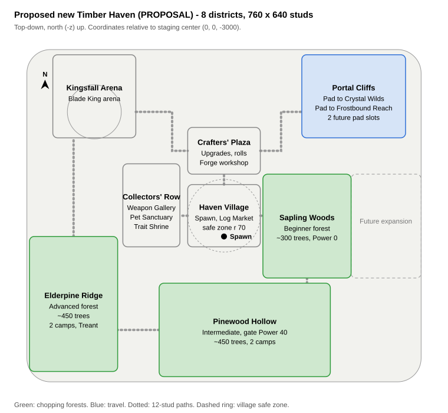

# Blade Forest — Timber Haven complete replacement design

**Status:** PROPOSAL, read-only planning for owner review (Option A: replace the original starting world). Nothing was changed in Studio, scripts, terrain, objects, saves, production or `main`.
**Date:** 2026-11-19 (PST). **Author:** Claude.
**Part of:** Master Game Completion Blueprint, milestone **M4a**.

**Supporting files in this folder:**

| File | What it holds |
| --- | --- |
| [`timber_haven_map.svg`](timber_haven_map.svg) | Top-down annotated map of the proposed island |
| [`district_layout.csv`](district_layout.csv) | District centers, sizes, world coordinates and legacy area ids |
| [`studio_inventory_raw.txt`](studio_inventory_raw.txt) | Raw output of the read-only Studio inventory queries |

**Tags used in this report:**

- **[VERIFIED]** means read from dev place 103379930563763 (Edit mode, read-only, nothing saved) or from the scripts on branch `p1b2r/camera-visibility-fix` @ `d222d98`.
- **[PROPOSAL]** means a design for approval.
- **[UNVERIFIED]** means an assumption to check before building.

---

## Summary

Timber Haven can be rebuilt as a compact **8-district island of about 760 × 640 studs** without touching any save, weapon id or purchase.

Three things make this safe:

- The physical layout is used by only a handful of scripts, mostly through one function, `GetAreaAt`.
- Every tree already carries its legacy `Area` id.
- Saves store area ids, never positions.

The main constraint is order. The old **Frost Peaks** region (921 trees) is the only place Frost trees exist today. It cannot be retired until Frostbound Reach is built, or the Frost tree index would become impossible to finish.

**What changes:**

- The original starting world is replaced: terrain, 4,401 trees, walls, camps, arena, plaza and stations.
- The legacy areas are re-expressed as districts on the new island:
    - Starter Grove becomes the beginner forest and village districts.
    - Pine Forest becomes the intermediate and advanced forests and the arena.
    - The legacy Crystal Canyon and Frost Peaks regions on Timber Haven are retired once their own islands carry them.

**What stays:**

- All gameplay systems and saved data.
- Weapon, tree and area ids.
- Crystal Wilds (dev v18) and the Frostbound Reach placeholder.
- The single-place, multi-island architecture.

---

## 1. Audit of the current starting world [VERIFIED]

The old starting world is a circle about 660 studs across, plus the Frost annex to the west. It holds:

- 4,401 trees (22,410 tree parts);
- 980 map parts;
- 4 spawn pads.

None of its map objects contain scripts. Full raw output is in [`studio_inventory_raw.txt`](studio_inventory_raw.txt).

| Object | Where (center, size in studs) | Count | Class |
| --- | --- | --- | --- |
| Terrain, legacy areas | x −720 to 420, z −440 to 440 (Timber Haven bounds in config) | — | Obsolete |
| Starter Grove trees | x −119 to 119, z −121 to 122 | 848 trees, 6,792 parts | Obsolete layout; tree types kept |
| Pine Forest trees | x −299 to 255, z −289 to 297 | 2,232 trees, 6,824 parts | Obsolete layout; tree types kept |
| Crystal Canyon trees (old) | x 199 to 298, z −124 to 123 | 400 trees, 3,188 parts | Obsolete; all 7 types already on Crystal Wilds |
| Frost Peaks trees (old) | x −633 to −379, z −152 to 151 | 921 trees, 5,606 parts | Retire **only after** Frostbound Reach is built |
| `SpawnLocation` × 4 | (±16, 1, 0) and (0, 1, ±16), 12 × 12 | 4 | Shared; moved to the new village |
| `Map.SpawnPlaza` | (0, 7, 0), 64 × 64 | 22 parts | Obsolete |
| `Map.Stations.LogMarket` | (24, 7, 24) | prompt `OpenPanel=Sawmill` | Shared station; prompt kept, building replaced |
| `Map.Stations.PetEgg` | (27, 11, 2) | prompt `OpenPanel=Pets` | Shared station; prompt kept, building replaced |
| `Map.TraitCrate` | (19, 4, −19) | `TraitPrompt` | Shared station; prompt kept, model replaced |
| `Map.Leaderboards` (Rarest, Logs, Hours) | west of spawn, (−26 to −36, 8, ±26) | 3 boards, 21 parts | Shared; moved |
| `Map.Camps` Camp_1–4 (Rogue Lumberjacks) | (±152, 9, ±152), 41 × 42, `Center` attribute | 4 camps, 504 parts | Shared NPC anchors; moved |
| `Map.BossArena` (Blade King) | (0, 8, −270), 104 across | 52 parts | Shared; moved with `Config.ArenaCenter` |
| `Map.AreaWalls` (StarterHedge, 4 Pine gates, Canyon walls and gate, Frost gate) | hedge radius 130; gates at ±130, (188, 0), (−345, 0) | 8 models, 144 parts | Obsolete; replaced by district gates |
| `Map.ClimbBlockers` | around mountains | 132 parts | Obsolete |
| `Map.Border` walls | ring at radius about 330, plus the Frost annex | about 36 parts | Obsolete |
| `Islands.TimberHaven` travel pads | Crystal Wilds pad (−12, 2, −26), Frostbound pad (12, 2, −26) | 2 pads, `TravelTo` prompts | Shared; moved to the portal hub |
| Ancient Treant spawn | config `WorldBoss.Position` (0, 0, 205) | — | Shared; moved |
| Slime spawn rings | radius 142–270 around the origin; Golden Slime box x 215–305 | code | Shared; re-pointed |
| Map lights and emitters | — | 22 lights, 6 emitters | Obsolete |
| Crystal Wilds, Frostbound placeholder | x about 3000 and 6000 | 620 trees; 20 island parts | **Must remain untouched** |
| `ServerStorage` import folders | WeaponImports2/3, TreeImports/2, NPCImports, PetImports, TraitChests, BoardTemplate | — | Not part of the world; security review is master milestone M0 |

**Other facts [VERIFIED]:**

- No roll-altar objects exist, and `Config.Altars` is not used by any script.
- `StreamingEnabled` is on.
- Event objects (slimes, bosses, the Treant) are spawned by scripts, not placed in the map.

## 2. Dependency map: old to new

Fourteen script dependencies touch the physical world; each has a planned replacement. Saved data never stores a position, so no save needs to change.

| Script or data | Reads today [VERIFIED] | New source [PROPOSAL] | Risk if missed |
| --- | --- | --- | --- |
| `BladeConfig.GetAreaAt` | Rings and boxes around the origin: Starter radius 130, Crystal x > 188, Frost x < −345, else Pine | A district table for Timber Haven. Each district names its legacy area id (Beginner → StarterGrove, Intermediate and Advanced → PineForest). Island lookup stays first | **Critical**: wrong area means wrong Power gate, prices, NPC rules and index |
| `AreaService` | `GetAreaAt` plus `RequiredPower` push-back; raises `BestArea` | Same logic on districts. `BestArea` only rises, as now | High |
| `ChopEffects` (client) | `Map.AreaWalls` gate parts with `RequiredPower` | New `Map.DistrictGates` folder with the same attribute | Medium (labels only) |
| `AutoChop` (client) | `GetAreaAt` for locked areas | Unchanged once `GetAreaAt` is updated | Medium |
| `WorldServer` camps | `Map.Camps` children with a `Center` attribute | Camp models in Pinewood Hollow and Elderpine Ridge, `Center` set | High (NPCs) |
| `WorldServer` slimes | Rings around the origin; Golden Slime box x 215–305 | Spawn boxes read from a `SlimeZones` table per district; the Crystal Wilds zone stays | Medium |
| `WorldServer` Blade King and `UIController` HP bar | `Config.ArenaCenter` (0, 0, −270), radius 48 | New arena center (config only) | High |
| `ExtrasService` Treant | `WorldBoss.Position` (0, 0, 205) plus a raycast to the ground | New clearing (config only) | Medium |
| Safe zone (PvP and NPC) | `SafeZoneCenter` (0, 0, 0), radius 32 | Village center, radius about 70 | High (PvP) |
| `TravelService` | Prompts with `TravelTo`; `Islands[TimberHaven].Arrival` (0, 5, 22); bounds | Pads moved to the portal hub; new Arrival and bounds in config | **Critical**: travel and respawn |
| `LeaderboardService` | `Map.Leaderboards` folder by name | Same folder name in the village | Low |
| `ExtrasController`, `TraitsController` | Prompt attributes (`OpenPanel`, `TraitPrompt`) | Same prompts on the new buildings | Medium |
| `CombatServer` respawn | Tree `Area` attribute, then `GetAreaAt(spot)` | Every new tree is stamped with its legacy `Area` at placement | High (rewards) |
| `TutorialController` | Nearest tree | Unchanged; first trees within 30 studs of spawn | Low |

**Protected and unchanged [PROPOSAL, checked against code]:**

- Save fields `BestArea`, `UnlockedIslands`, `LastIsland`, `Trees`, `TreeClaimed`, `TreeIndexDone`, `MutationsFound`, `IndexDone`, `Achievements` and `Purchases`.
- Weapon ids.
- Legacy area ids StarterGrove, PineForest, CrystalCanyon and FrostPeaks.
- Server-authoritative combat and rewards.
- Entitlements.
- Crystal Wilds and the Frostbound placeholder.

**[UNVERIFIED]** No other script hard-codes old coordinates. A full search of `src/` found only the items above, but imported models were not read line by line.

## 3. New Timber Haven: 8 districts [PROPOSAL]

The island is 760 × 640 studs, built around a central village, with every district one short walk from it. It is built at a **staging center of (0, 0, −3000)**, away from the old world. The old layout keeps running until cutover and stays available for rollback.

Coordinates below are relative to that center; add −3000 to z for world coordinates. The same data is in [`district_layout.csv`](district_layout.csv).

| # | District | Holds | Center (x, z) | Size (x × z) | Legacy area id |
| --- | --- | --- | --- | --- | --- |
| 1 | Haven Village | Spawn pads, safe zone (radius 70), Log Market, leaderboards, tutorial signs | (0, 0) | 140 × 120 | StarterGrove |
| 2 | Crafters' Plaza | Upgrade and roll plaza; Blacksmith and Forge workshop (shell until M6) | (0, −125) | 140 × 90 | StarterGrove |
| 3 | Collectors' Row | Weapon Gallery hall, Pet Sanctuary (egg), Trait Shrine (crate) | (−140, −20) | 110 × 160 | StarterGrove |
| 4 | Sapling Woods | Beginner forest; first trees 25 studs from spawn; slimes on its far edge | (160, 20) | 170 × 200 | StarterGrove |
| 5 | Pinewood Hollow | Intermediate forest; gate at Power 40; Big Slimes; 2 camps | (40, 220) | 330 × 180 | PineForest |
| 6 | Elderpine Ridge | Advanced forest; 2 Rogue Lumberjack camps; Ancient Treant clearing | (−290, 170) | 170 × 260 | PineForest |
| 7 | Kingsfall Arena | Blade King arena (104 across), viewing terraces | (−250, −230) | 160 × 160 | PineForest |
| 8 | Portal Cliffs | Pads to Crystal Wilds and Frostbound Reach, requirement boards, 2 empty pad slots for future islands | (250, −230) | 200 × 160 | StarterGrove |

- The east meadow (x 245 to 380, z −80 to 120) is left empty for future expansion.
- All 4 Rogue Lumberjack camps stay: 2 in Pinewood Hollow and 2 in Elderpine Ridge.
- The Golden Slime zone moves fully to Crystal Wilds, which removes today's shared-cap issue.

**Paths.**

- 12-stud paths link the districts.
- The main loop runs: Village → Sapling Woods → Pinewood Hollow → Elderpine Ridge → Kingsfall Arena → Crafters' Plaza → Portal Cliffs.
- 8-stud spurs lead back to the village.
- Every district is under 45 seconds' walk from spawn at default speed.

**District gates.** A stone arch with a Power sign replaces the hedge and walls. It carries the `RequiredPower` attribute that ChopEffects already reads.

## 4. Annotated island map [PROPOSAL]



The forests ring the village on three sides, so a new player sees trees in every direction. Services sit north of spawn, and the portal sits where the main loop ends.

Text version, north (−z) up:

```
 z=-320 +---------------------------------------------------------------+
        | [Kingsfall Arena]                          [Portal Cliffs]    |
        |   Blade King          [Crafters' Plaza]     CW pad, FR pad,   |
        |                        upgrades, rolls,     2 future slots    |
        |                        forge                                  |
        |          [Collectors'] [Haven Village]  [Sapling   ] [future  |
        |           Gallery,      SPAWN, market,   Woods     ] expansion|
        |           pets, traits  safe zone        beginner  ]         ]|
        | [Elderpine ]                                                  |
        |  Ridge     ]          [ Pinewood Hollow                ]      |
        |  advanced, ]          [ intermediate, gate Power 40    ]      |
        |  camps,    ]          [ 2 camps                        ]      |
        |  Treant    ]                                                  |
 z=+320 +---------------------------------------------------------------+
       x=-380                                                        x=+380
```

## 5. Tree density, chopping routes and the first 10 minutes [PROPOSAL]

The island keeps about **1,200 trees** (down from 4,401), laid out in the dense style that worked on Crystal Wilds. Mean nearest-neighbour spacing is about 5.2 studs inside zones, with clear trails between them.

| District | Trees | Zones | Rarity mix (legacy area tree types) | Route |
| --- | --- | --- | --- | --- |
| Sapling Woods | about 300 | 2 dense zones plus a 30-tree fringe at the village edge | StarterGrove: mostly Common and Uncommon, a few Rare | A loop of about 25 s touching 15+ trees per sweep |
| Pinewood Hollow | about 450 | 3 zones | PineForest: Common to Epic | A figure-eight around 2 camps |
| Elderpine Ridge | about 450 | 3 zones, with a clearing for the Treant | PineForest, weighted to Rare to Secret | A ridge path with switchbacks, about 40 s |

- Rarity weights and mutations use the existing `PickTreeType` and `RollMutation`.
- Every tree is stamped `Area = StarterGrove` or `PineForest` at placement, so tree index entries, rewards and respawns are unchanged.
- The placement tooling follows the P1b.2/P1b.2r method: a manifest CSV, a dry run, then placement.

**[VERIFIED]** All 7 Crystal Canyon tree types already exist on Crystal Wilds.

**[UNVERIFIED]** The 7 Frost Peaks tree types will exist on Frostbound Reach after it is built.

### First 10 minutes

| Time | Player does | What the island does |
| --- | --- | --- |
| 0:00 | Spawns in Haven Village, facing east | The tutorial arrow points at the Sapling Woods fringe, 25 studs away |
| 0:20 | First chop | Logs pop; the tutorial explains blades |
| 1:30 | Buys +1 Blade at Crafters' Plaza | The upgrade station opens the existing Upgrades panel |
| 2:30 | First rolls at the roll plaza | Auto-roll is explained; the weapon equips |
| 4:00 | Opens a Trait Crate and a first egg in Collectors' Row | Stations open the existing panels |
| 5:00 | Reaches Power 40 | The Pinewood Hollow gate arch turns green |
| 6:00–8:00 | Chops through Pinewood Hollow | First Rogue Lumberjack camp; Souls drop |
| 8:30 | Passes Kingsfall Arena on the loop | The Blade King timer shows; the arena is visible from the path |
| 9:30 | Arrives at Portal Cliffs | The Crystal Wilds board shows the 3 requirements and the player's progress |

The requirement board needs the island-gate checklist from master milestone M1. Until then, the existing Power-based travel gate applies.

## 6. Assets and performance [PROPOSAL]

Reuse the trees and NPC rigs already in the place. Everything else comes from the **Creator Store**, in one cohesive low-poly fantasy-village style; no custom models.

Each pick is logged with asset id, creator and license, and checked for scripts before insertion, as in `docs/p1b_asset_manifest.json`.

| Need | Count | Source | Notes |
| --- | --- | --- | --- |
| Trees (StarterGrove and PineForest types) | about 1,200 | **Existing** `TreeModels` templates via TreeKit | No new tree assets |
| Village kit: houses, market stalls, fences, lamps, well | 1 pack | Creator Store | Several cottage variants |
| Blacksmith and forge building | 1 | Creator Store | Shell only until M6 |
| Gallery hall, pet sanctuary, trait shrine | 3 | Creator Store | The Gallery interior serves the M2 Gallery |
| Upgrade and roll stations (pedestals, altar) | 2 | Creator Store | Prompts added by the builder |
| Gate arches with signs | 2 (Pinewood, Elderpine) | Creator Store | Carry the `RequiredPower` attribute |
| Arena (stone ring, stands) | 1 | Creator Store, or reuse `Map.BossArena` | Reusing keeps 52 known-good parts |
| Portal frames | 4 (2 active, 2 future) | Creator Store | Island-coloured |
| Rogue Lumberjack camps | 4 | **Existing** `Map.Camps` models, moved | Keep the `Center` attributes |
| Leaderboards | 3 | **Existing**, moved | Folder name unchanged |
| Terrain | 760 × 640 | Terrain tools (not an asset) | Grass, paths, rock cliffs, a river and water edge |
| Landmarks: big old tree, waterfall, lighthouse at the portal | 2–3 | Creator Store | Optional, last |

### Performance budget, while standing on Timber Haven

| Item | Old world [VERIFIED] | New budget [PROPOSAL] |
| --- | --- | --- |
| Tree parts | 22,410 (4,401 trees) | ≤ 9,000 (about 1,200 trees) |
| Map and building parts | 980 | ≤ 3,000 (prefer meshes) |
| Lights | 22 | ≤ 30, shadows off on decorative lights |
| Particle emitters | 6 | ≤ 20 |
| Unique meshes and textures | — | Reuse kit pieces; texture atlas where possible |

Other rules:

- Streaming stays on.
- Decorative buildings are anchored and non-collidable.
- The camera-visibility fix in ChopEffects applies automatically, because it reads any `Breakables` tree.
- Every stage is checked on iPhone, not only in Studio. MacBook Studio frame rates are not representative.

## 7. Retirement, migration and rollback [PROPOSAL]

Nothing is deleted at cutover. The old world is moved into an archive folder, and switching back is one config flag plus moving the archive back.

### What happens to each part

| Part | Fate | When |
| --- | --- | --- |
| Old terrain (x −720 to 420) | Kept in place, unreachable after cutover; cleared only with later approval | After a 2-week soak |
| Starter Grove and Pine Forest trees (3,080) | Archived to `ServerStorage.LegacyTimberHaven` | Cutover |
| Old Crystal Canyon trees (400) | Archived | Cutover |
| Old Frost Peaks trees (921) | **Kept live** until Frostbound Reach carries all 7 Frost types, then archived | After Frostbound Reach |
| SpawnPlaza, AreaWalls, ClimbBlockers, Border, map lights | Archived | Cutover |
| SpawnLocations × 4 | Moved to Haven Village | Cutover |
| Stations, TraitCrate, Leaderboards, Camps, BossArena | Moved to their districts. Models may be swapped for kit pieces; prompts and attributes are kept | Cutover |
| Travel pads | Moved to Portal Cliffs | Cutover |
| Crystal Wilds, Frostbound placeholder | Unchanged | — |
| Save data, ids, purchases, entitlements | Unchanged; no migration step needed | — |

### Non-destructive legacy-area mapping

- A new config table `TimberHavenLayout` holds the district rectangles and their legacy area ids.
- A flag selects `"legacy"` (today's rings) or `"v2"` (the districts).
- `GetAreaAt`, the safe zone, `ArenaCenter`, `WorldBoss.Position`, slime zones and the Timber Haven `Arrival` and bounds all read from that one table.
- Building happens with the flag on `"legacy"`, so players never notice.
- Cutover is flipping the flag to `"v2"`.

### Staged construction and cutover

1. **Backup.** Save a dev place checkpoint, export an offline `.rbxl` copy (the P0 method) and tag the git commit.
2. **Build.** Build the new island at the staging center (0, 0, −3000) with the flag on `"legacy"`. It is reachable only through a Studio-only test pad.
3. **Test.** Run the TH-5 test list (section 8) with the flag set to `"v2"` in a playtest only.
4. **Cut over.** Flip the flag, move the shared objects, archive the old objects and save the dev place.
5. **Soak.** Play for 2 weeks, including an iPhone check and a two-device test.
6. **Clean up.** Only with owner approval: remove archived trees and old terrain.

### Verification that player data stays valid

| Check | Expected |
| --- | --- |
| Load 5+ real dev saves before and after cutover and diff them | No field changes except normal play stats |
| `BestArea` StarterGrove, PineForest, CrystalCanyon or FrostPeaks | The player spawns on Timber Haven and keeps their island unlocks |
| `LastIsland = TimberHaven` | Respawn at the new village |
| Tree index | Same entries and counts; new chops add to the same tree type ids |
| Purchases and passes | Unchanged; VIP tag and multipliers recalculated as before |

### Rollback

1. Set the flag back to `"legacy"`.
2. Move the shared objects and the archived folder back by running the cutover script in reverse. The script records every move.
3. If anything is still wrong, revert the dev place to the pre-cutover checkpoint version.

No save is touched in any of these steps, so a rollback cannot lose progress.

## 8. Construction sequence, tests, risks and decisions [PROPOSAL]

The rebuild becomes master milestone **M4a**. It runs after M0 (save safety) and M1 (progression core), and before Frostbound Reach (M4b). Each stage has its own approval, checkpoint and handoff.

### Stages

| Stage | Work | Scripts touched | Done when |
| --- | --- | --- | --- |
| TH-0 | Backup, checkpoint, git tag, asset shortlist with ids | None | Owner approves the asset list |
| TH-1 | Terrain and paths at the staging center | None | Walkable; iPhone frame rate checked |
| TH-2 | `TimberHavenLayout` config and flag; `GetAreaAt`, safe zone, arena, Treant and slime zones read it | BladeConfig, WorldServer (slime zones) | With the flag on `"legacy"`, behaviour is identical to today (regression test) |
| TH-3 | Trees placed by manifest (about 1,200), stamped with legacy `Area` | None (tooling only, as in P1b) | Counts and spacing match the manifest |
| TH-4 | Buildings, stations, gates, arena, portals, landmarks | Small client change: station prompts for the Upgrades and Roll panels (MetaController, RollController) | All prompts open the right panel |
| TH-5 | Playtest with the flag on `"v2"`; full test list below | None | All tests pass |
| TH-6 | Cutover, then a 2-week soak | None (the cutover script only moves objects) | Owner sign-off |

### Test list for TH-5

1. A new player completes the first 10 minutes as planned and is never stuck or wrongly pushed back.
2. Every position inside each district returns its expected legacy area. Test 4 sample points per district plus the borders.
3. The Pinewood and Elderpine gates block and push back below Power 40.
4. Each district has the right NPCs. No NPC enters the village or Sapling Woods.
5. The Blade King spawns, the HP bar shows only in the arena, and rewards are paid.
6. The Treant spawns in the Elderpine clearing.
7. Travel works both ways from Portal Cliffs, and respawn lands in the village.
8. The save diff and index checks in section 7 pass.
9. The budgets in section 6 are met, and the iPhone check passes.
10. The camera fix works in all three forests.

### Risks

| Risk | Severity | Mitigation |
| --- | --- | --- |
| A wrong district rectangle sends players to the wrong area (gate, price, index) | Critical | Sample-point test (2), with the legacy flag kept for instant rollback |
| The Frost tree index becomes impossible if old Frost Peaks is retired early | Critical | Keep it live until Frostbound Reach exists (decision T1) |
| An imported building kit contains scripts | High | Strip and scan before insertion; log the asset id |
| Too many building parts on iPhone | Medium | Budget in section 6; meshes over parts |
| The first session feels longer with a bigger village | Medium | Trees 25 studs from spawn; the tutorial arrow points there first |
| Players lose landmarks they know | Low | Same station names and leaderboards; a sign in the village |

### Decisions for the owner

| # | Decision | Recommended default |
| --- | --- | --- |
| T1 | Cut over before Frostbound Reach exists? If yes, Portal Cliffs gets a temporary "Frost Peaks (legacy)" pad to the old Frost region until M4b | No: cut over after Frostbound Reach; build TH-0 to TH-5 before it |
| T2 | Keep the new island at the staging center permanently, or move it to the origin after the old terrain is cleared | Keep it at (0, 0, −3000): no second migration |
| T3 | District names (Haven Village, Crafters' Plaza, Collectors' Row, Sapling Woods, Pinewood Hollow, Elderpine Ridge, Kingsfall Arena, Portal Cliffs) | Use as proposed; rename freely before TH-4 |
| T4 | Visual style for the Creator Store kit (cosy low-poly village, or medieval stone) | Cosy low-poly, matching the existing trees |

Frostbound Reach and every other construction milestone remain **unapproved**. This report authorizes nothing by itself.
